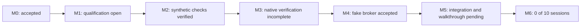

# Compertum

A supervised research system with reproducible experiments, bounded AI proposals, independent audits, and controlled paper-trading development.

Updated 15 October 2026. **Working folder: `C:\Users\bgonn\Desktop\Compertum`.** GitHub stores code, configuration, tests, plans and reports for rollback. Credentials, provider data, runtime databases, environments and detailed local evidence stay outside Git.

**Primary repository: [BGonnermann/Compertum](https://github.com/BGonnermann/Compertum)** (private). Future updates use the BGonnermann account. The previous repository remains a historical reference; the full commit history is preserved.

## Current position

Original intent release18 is verified:393 matching cases per environment, including all106 formerly pending installed cases; final original-release review3 CLEAR. The native storage scanner separately passed43 matching source/package cases,18 C boundary cases, both complete environment checks and three full-master scans within the unchanged five-second/one-CPU/128MiB limits. Times:4.566,4.948,4.930seconds; the last uses the original watchdog volume callback. Final native review6 is CLEAR. Scan headroom is narrow; preserve closed passing scratch before further fixture growth. See [intent verification](reports/M5_NATIVE_INTENTS.md), [native storage evidence](reports/M5_NATIVE_STORAGE.md) and [the current checkpoint](docs/CURRENT_CHECKPOINT.md). Ownership/accounting, risk, durable dispatch/recovery and the local rehearsal remain open. M6 is0/10 actual supervised sessions.

Current storage admission remains blocked after the broader native experiment used rounds10 through12. The aligned private candidate matched two small inventories, then timed out after83,623 files. All23,749 handles closed under the unchanged one-CPU/128MiB/five-second watchdog; no prototype entered the product. Product code is unchanged. Reader19 remains34 private cases, zero executed and no implementation; M5 local gates2 through5 remain open. No failed fixture was removed. See [the measured experiment and unresolved decision](reports/M5_NATIVE_BATCH_EXPERIMENT.md).

A [four-folder execution procedure](docs/FIXTURE_CONSOLIDATION_EXECUTION_PROCEDURE.md) is now prepared for review. The owner selected historical evidence copies. Fresh checks matched all 1,827 selected entries, found no incoming links among 1,638 retained master links, and found zero coordinator reservations. The proposed 1.5 MiB backup allowance fits with 129,056 bytes left after all backup overhead. The complete budget also covers preparation, publication and later execution records without crediting future deletion.

Scratch storage remains 310,888 bytes over its 5 GiB limit. The procedure therefore requires explicit review and approval of maintenance that adds no scratch files. Stage A creates and verifies historical copies, then stops with the four originals intact. Removal needs separate approval. No archive or original-folder removal has run, and ordinary work and requested-clone updates remain stopped. A successful later production check is still required.

The owner-approved administrator cleanup has now removed exactly 31 old shortcuts. A separate live check confirmed all 31 target folders are unchanged and all links are absent. No permissions changed. The original failed launches and saved link records remain preserved; all 217 source and installed program files still match. The [cleanup report](docs/FIXTURE_CONSOLIDATION_GATES.md) explains the earlier Windows permission failure and the remaining storage decisions.

Private final input proofs are verified with **277 identical passing cases per source/installed environment**, zero failures/errors/skips, both complete environment checks and final aggregate review CLEAR. Grouped proofs check original account, market and presence evidence after callbacks finish and preserve caller transactions. See [the proof report](reports/M5_INPUT_PROOFS.md). Next: exact native intent and confirmation records.

Account and presence integrity is verified with **222 identical passing cases per source/installed environment**, zero failures/errors/skips, complete environment checks and final review CLEAR2/3. Late validation callbacks cannot hide changed originals or revoked presence; invalid acknowledgements are refused before insertion. See [the integrity report](reports/M5_ACCOUNT_PRESENCE_INTEGRITY.md). Next: exact native intent and confirmation records.

Combined-input integrity is verified with **151 identical passing cases per source/installed environment**, zero failures/errors/skips, complete environment checks and final review CLEAR3/3. Original evidence is rechecked after callbacks; account-health refusal preserves borrowed historical data. See [the integrity report](reports/M5_INPUT_INTEGRITY.md). Account/presence callback repair is now verified above.

Account-only inputs have **306 identical passing cases per source/installed environment**, zero failures/errors/skips, both complete environment checks and verified aggregate evidence. Corrupt opening artifacts and history now refuse permanently while valid nonempty history remains readable. Final independent review3/3 is CLEAR. See [the account-context report](reports/M5_ACCOUNT_CONTEXT.md). Subsequent combined-context repair is described above; account/presence callback repair is verified above.

Native operator presence is verified with **314 identical passing cases per source/installed environment**, zero failures/errors/skips, both complete environment checks and final independent review CLEAR4/4. The repair prevents a refused acknowledgement from being committed by a health-halt callback. Presence expires permanently and grants no broker authority. See [the presence report](reports/M5_NATIVE_PRESENCE.md). Account-only inputs and subsequent integrity repairs are covered above.

The private account/market input context has **255 matching passing cases per source/installed environment**, zero failures/errors/skips, complete environment qualification and verified aggregate evidence. It binds original observations and permanently refuses invalidated contexts. Final independent review3/3 is CLEAR; all order admission remains blocked. See [the input-context report](reports/M5_INPUT_CONTEXT.md).

Durable market-input publication now has **696 matching passing cases in each source/installed environment**, including the full Windows restart/lost-acknowledgement lifecycle. Both complete environments and aggregate verification passed; final independent review3/3 is CLEAR. Original captures survive restart as historical evidence without restoring freshness or trading authority. The next implementation is native paper admission. See [the publication report](reports/M5_MARKET_LINEAGE_PUBLICATION.md) and [admission plan](docs/M5_PAPER_ADMISSION_PLAN.md).

The daily runtime cap is removed: **27 source and 27 installed-package checks passed**. Per-job deadlines and CPU, memory and storage limits remain.

The M3 two-module validation repair passed **592 distinct matching tests in each source/installed environment**, with zero test failures, errors or skips. Both complete environment qualifications passed with unchanged Python and 38 dependencies. That frozen release contains 486 files and 190 matching product modules. Separate storage-preflight refusals are preserved and do not count as passing tests.

M5 collection retries are now integrated and independently reviewed: **521 matching required cases passed per environment**, including real non-sparse 1 GiB reserve creation and reopening. Source results combine 520 checks with explicit unchanged-code continuity and one fresh corrected test; all 521 installed checks ran against the final test release. That verified release has 496 frozen files and 192 product modules. Both complete environments qualified. See [the retry integration report](reports/M5_RETRY_INTEGRATION.md).

M5 opening-baseline integration is also verified and independently reviewed: **221 matching fresh cases passed per environment** (95 opening and 126 compatibility checks). Genuine process restart preserves the original baseline without restoring live authority. A discovered negative-cash diagnostic bug was fixed and all cases rerun. That verified release has 502 frozen files and 194 modules. See [the opening integration report](reports/M5_OPENING_INTEGRATION.md).

The market-owner repair has **394 matching passing tests in both source and installed-package environments**, including the real-process restart scenario, plus 11 source-backed native connection checks. Both complete environments and aggregate evidence verification passed. The fix preserves healthy connections after an acknowledged busy-checkpoint reply; broken connections still close. Earlier failed evidence remains preserved. Subsequent durable-lineage checks are described above; the actual walkthrough remains open. See [the repair report](reports/M5_MARKET_OWNER_REPAIR.md).

The market-input capture foundation has **225 matching passing tests per environment**. It retains one coherent snapshot and reconstructs the original diagnostic from exact bytes. Both complete environments qualified. Subsequent consumption and publication checks build on this foundation. See [the foundation report](reports/M5_MARKET_LINEAGE_FOUNDATION.md).

Original grant consumption and owner-bound capture have **291 matching passing checks per environment**. Consumption commits before collection begins; capture reads its original records from the execution owner. Private encrypted lineage storage/reopening has **243 matching passing checks per environment** and both complete environments qualified. Its final aggregate review3/3 is CLEAR. Durable publication and native recovery are covered by the newer696-case inventory above. See [the encryption report](reports/M5_MARKET_LINEAGE_ENCRYPTION.md) and [consumption report](reports/M5_MARKET_CONSUMPTION.md).

The repaired M3 release completed **63 of 63 calculations in each campaign**, with all 63 source and installed-package outputs matching exactly. Across 120 native chunks, no calculation failed or was skipped. Controls also responded during pending output verification. **All 77 audits/reviews, the Final calculation and its restart checks passed.** The source Final audit passed pause/resume and terminal restart. Four separate three-ridge calculation/audit jobs also passed, with six annual fits and exact source/package outputs. The installed-package audit was interrupted before saving its process-exit receipt and cannot be accepted or retried. M3 remains incomplete. All saved files are preserved, but a failed backup move changed directory identities; the archived runtime cannot resume. See [the interruption report](reports/M3_FINAL_INTERRUPTION.md). Work stays in master, with one heavy job at a time and memory checks. **Strata stays off.** Complete M3 acceptance remains open. See [the live checkpoint](docs/CURRENT_CHECKPOINT.md) and [required acceptance evidence](docs/M3_MASTER_ACCEPTANCE_MAP.md).

Two earlier M3 runs remain terminally blocked and preserved: the development-folder run stopped after 37 reviews, and the preceding master run after 76. Both reached a stale-health refusal before the blocked worker executed. The repairs preserve the five-second health limit and final seal checks. Earlier component coverage remains historical, not fresh coverage of the repaired release. See [the recovery report](reports/M3_INTERRUPTION_RECOVERY.md), [health repair](docs/M3_REVIEW_HEALTH_REPAIR.md) and [pair-validation repair](docs/M3_PAIR_VALIDATION_REPAIR.md).

| Milestone | Status |
| --- | --- |
| M0: Local foundation and controls | Accepted; preserved acceptance evidence |
| M1: Trustworthy research inputs | Bounded real-data replay verified; full financial input qualification open |
| M2: Strategies and mathematical checks | Synthetic components verified; financial qualification open |
| M3: Protected evaluation and audit | Repaired campaigns 63/63 each and exactly matched; 77/77 reviews and Final/restart passed; installed Final audit interrupted, acceptance open |
| M4: Simulated broker | Fake-broker engineering accepted; 662 matching source/package checks |
| M5: Supervised paper walkthrough | Retries, opening baseline and durable lineage checks verified; native admission and actual walkthrough pending |
| M6: Daily supervised operation | Evidence structure implemented; **0 of 10 actual supervised market sessions** |

Engineering checks do not establish strategy acceptance or authorize account/order actions. M6 requires actual supervised market sessions.

## Next work

1. Master consolidation published and verified; keep pushing verified checkpoints.
2. M3 partial closeout and independent checks are verified; the interrupted installed Final audit remains blocked. Strata stays off.
3. M5 retries and opening baseline are verified; original failed evidence remains preserved.
4. Durable lineage, the private input context and native presence are verified and independently reviewed. Account-only inputs passed paired verification and final review. Combined-context integrity is verified; account/presence callback repair is verified; continue exact plans, risk and reconciliation under the admission plan.

[Current checklist](docs/CURRENT_CHECKPOINT.md) | [Build specification](docs/BUILD_SPEC.md) | [Cap removal](reports/DAILY_RUNTIME_CAP_REMOVAL.md) | [M0 acceptance](reports/M0_ACCEPTANCE.md) | [M4 acceptance](reports/M4_ACCEPTANCE.md)

## Checkpoints and rollback

Work in master. Commit and push completed, verified changes at each meaningful checkpoint under the owner's standing authorization. Record unfinished checks explicitly. Preserve commits; never force-push or reset history to make a checkpoint look clean. No scheduled run is needed.

Sibling folders retain historical environments and evidence. Their path-bound runtime records are not relocated or relabeled as master-folder results. Git rollback restores tracked files; runtime/data recovery requires the local backups and receipts. Historical reports may reference local evidence that is intentionally absent from GitHub.
