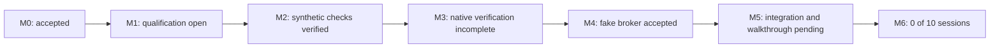

# Compertum

A supervised research system with reproducible experiments, bounded AI proposals, independent audits, and controlled paper-trading development.

Updated 14 October 2026. **Working folder: `C:\Users\bgonn\Desktop\Compertum`.** GitHub stores code, configuration, tests, plans and reports for rollback. Credentials, provider data, runtime databases, environments and detailed local evidence stay outside Git.

## Current position

The daily runtime cap is removed: **27 source and 27 installed-package checks passed**. Per-job deadlines and CPU, memory and storage limits remain.

The M3 two-module validation repair passed **592 distinct matching tests in each source/installed environment**, with zero test failures, errors or skips. Both complete environment qualifications passed with unchanged Python and 38 dependencies. That frozen release contains 486 files and 190 matching product modules. Separate storage-preflight refusals are preserved and do not count as passing tests.

M5 collection retries are now integrated and independently reviewed: **521 matching required cases passed per environment**, including real non-sparse 1 GiB reserve creation and reopening. Source results combine 520 checks with explicit unchanged-code continuity and one fresh corrected test; all 521 installed checks ran against the final test release. The current release has 496 frozen files and 192 product modules. Both complete environments qualified. See [the retry integration report](reports/M5_RETRY_INTEGRATION.md).

M5 opening-baseline integration is also verified and independently reviewed: **221 matching fresh cases passed per environment** (95 opening and 126 compatibility checks). Genuine process restart preserves the original baseline without restoring live authority. A discovered negative-cash diagnostic bug was fixed and all cases rerun. That verified release has 502 frozen files and 194 modules. See [the opening integration report](reports/M5_OPENING_INTEGRATION.md).

The market-owner integration has **341 passing source checks** and clear component reviews. It now connects collection, encrypted publication, fresh-input composition and authenticated public routing. Real process/RPC integration and installed-package verification remain pending. See [the engineering checkpoint](reports/M5_MARKET_OWNER_PROGRESS.md).

The repaired M3 release completed **63 of 63 calculations in each campaign**, with all 63 source and installed-package outputs matching exactly. Across 120 native chunks, no calculation failed or was skipped. Controls also responded during pending output verification. **All 77 audits/reviews, the Final calculation and its restart checks passed.** The source Final audit passed pause/resume and terminal restart. Four separate three-ridge calculation/audit jobs also passed, with six annual fits and exact source/package outputs. The installed-package audit was interrupted before saving its process-exit receipt and cannot be accepted or retried. M3 remains incomplete. All saved files are preserved, but a failed backup move changed directory identities; the archived runtime cannot resume. See [the interruption report](reports/M3_FINAL_INTERRUPTION.md). Work stays in master, with one heavy job at a time and memory checks. **Strata stays off.** Complete M3 acceptance remains open. See [the live checkpoint](docs/CURRENT_CHECKPOINT.md) and [required acceptance evidence](docs/M3_MASTER_ACCEPTANCE_MAP.md).

Two earlier M3 runs remain terminally blocked and preserved: the development-folder run stopped after 37 reviews, and the preceding master run after 76. Both reached a stale-health refusal before the blocked worker executed. The repairs preserve the five-second health limit and final seal checks. Earlier component coverage remains historical, not fresh coverage of the repaired release. See [the recovery report](reports/M3_INTERRUPTION_RECOVERY.md), [health repair](docs/M3_REVIEW_HEALTH_REPAIR.md) and [pair-validation repair](docs/M3_PAIR_VALIDATION_REPAIR.md).

| Milestone | Status |
| --- | --- |
| M0: Local foundation and controls | Accepted; preserved acceptance evidence |
| M1: Trustworthy research inputs | Bounded real-data replay verified; full financial input qualification open |
| M2: Strategies and mathematical checks | Synthetic components verified; financial qualification open |
| M3: Protected evaluation and audit | Repaired campaigns 63/63 each and exactly matched; 77/77 reviews and Final/restart passed; installed Final audit interrupted, acceptance open |
| M4: Simulated broker | Fake-broker engineering accepted; 662 matching source/package checks |
| M5: Supervised paper walkthrough | Retries and opening baseline verified; market-owner integration and actual walkthrough pending |
| M6: Daily supervised operation | Evidence structure implemented; **0 of 10 actual supervised market sessions** |

Engineering checks do not establish strategy acceptance or authorize account/order actions. M6 requires actual supervised market sessions.

## Next work

1. Master consolidation published and verified; keep pushing verified checkpoints.
2. M3 partial closeout and independent checks are verified; the interrupted installed Final audit remains blocked. Strata stays off.
3. M5 retries and opening baseline are verified; original failed evidence remains preserved.
4. Complete market-owner process/RPC fixtures and paired native verification; its341-case source checkpoint is verified.

[Current checklist](docs/CURRENT_CHECKPOINT.md) | [Build specification](docs/BUILD_SPEC.md) | [Cap removal](reports/DAILY_RUNTIME_CAP_REMOVAL.md) | [M0 acceptance](reports/M0_ACCEPTANCE.md) | [M4 acceptance](reports/M4_ACCEPTANCE.md)

## Checkpoints and rollback

Work in master. Commit and push completed, verified changes at each meaningful checkpoint under the owner's standing authorization. Record unfinished checks explicitly. Preserve commits; never force-push or reset history to make a checkpoint look clean. No scheduled run is needed.

Sibling folders retain historical environments and evidence. Their path-bound runtime records are not relocated or relabeled as master-folder results. Git rollback restores tracked files; runtime/data recovery requires the local backups and receipts. Historical reports may reference local evidence that is intentionally absent from GitHub.
