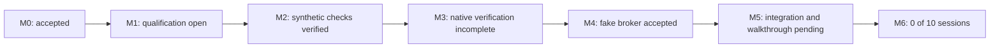

# Compertum

A supervised research system with reproducible experiments, bounded AI proposals, independent audits, and controlled paper-trading development.

Updated 13 October 2026. **Working folder: `C:\Users\bgonn\Desktop\Compertum`.** GitHub stores code, configuration, tests, plans and reports for rollback. Credentials, provider data, runtime databases, environments and detailed local evidence stay outside Git.

## Current position

The daily runtime cap is removed: **27 source and 27 installed-package checks passed**. Per-job deadlines and CPU, memory and storage limits remain.

The frozen Final auditor release passed the same **545 distinct component checks in each environment**. Fresh master verification now covers **311 distinct cases per environment**, including all218 previously missing negative/control checks, with zero failures, errors or skips in the accepted paired runs. These sets overlap by37 cases:819 distinct cases per environment in total. The initial interrupted and access-denied runs remain recorded. See [the consolidation report](reports/MASTER_CONSOLIDATION.md).

The interrupted M3 campaign recovered through the normal restart path. Both campaigns now have63/63 completed outcomes, with all63 mathematical outputs matching exactly.37 of77 audits/reviews completed; the source aggregate stopped on an unverified-health refusal and remains blocked. A native regression reproduced stale cached health after slow preparation. The repair passed274 distinct cases in each environment;70 further native checks per environment are pending. Full M3 evidence requires new campaign identities, including audits and Final checks. Strata stays off. See [the recovery report](reports/M3_INTERRUPTION_RECOVERY.md) and [repair checkpoint](docs/M3_REVIEW_HEALTH_REPAIR.md). Full M3 acceptance remains incomplete.

| Milestone | Status |
| --- | --- |
| M0: Local foundation and controls | Accepted; preserved acceptance evidence |
| M1: Trustworthy research inputs | Bounded real-data replay verified; full financial input qualification open |
| M2: Strategies and mathematical checks | Synthetic components verified; financial qualification open |
| M3: Protected evaluation and audit | 545 paired component checks and63/63 native campaign comparison passed; audits/Final acceptance incomplete |
| M4: Simulated broker | Fake-broker engineering accepted; 662 matching source/package checks |
| M5: Supervised paper walkthrough | Component verification underway; integration and actual walkthrough pending |
| M6: Daily supervised operation | Evidence structure implemented; **0 of 10 actual supervised market sessions** |

Engineering checks do not establish strategy acceptance or authorize account/order actions. M6 requires actual supervised market sessions.

## Next work

1. Master consolidation published and verified; keep pushing verified checkpoints.
2. Owner approved finishing the frozen test in its historical folder. Storage admission and interruption recovery passed; continue serial verification with memory checks. Strata must not be started.
3. Verify the review-health repair, freeze a new release, then complete fresh M3 audits and Final checks. Preserve the blocked original run.
4. Integrate the prepared M5 retry/opening changes and continue the accepted engineering gates.

[Current checklist](docs/CURRENT_CHECKPOINT.md) · [Build specification](docs/BUILD_SPEC.md) · [Cap removal](reports/DAILY_RUNTIME_CAP_REMOVAL.md) · [M0 acceptance](reports/M0_ACCEPTANCE.md) · [M4 acceptance](reports/M4_ACCEPTANCE.md)

## Checkpoints and rollback

Work in master. Commit and push completed, verified changes at each meaningful checkpoint under the owner's standing authorization. Record unfinished checks explicitly. Preserve commits; never force-push or reset history to make a checkpoint look clean. No scheduled run is needed.

Sibling folders retain historical environments and evidence. Their path-bound runtime records are not relocated or relabeled as master-folder results. Git rollback restores tracked files; runtime/data recovery requires the local backups and receipts. Historical reports may reference local evidence that is intentionally absent from GitHub.
