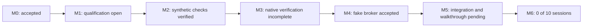

# Compertum

A supervised research system with reproducible experiments, bounded AI proposals, independent audits, and controlled paper-trading development.

Updated 13 October 2026. **Working folder: `C:\Users\bgonn\Desktop\Compertum`.** GitHub stores code, configuration, tests, plans and reports for rollback. Credentials, provider data, runtime databases, environments and detailed local evidence stay outside Git.

## Current position

The daily runtime cap is removed: **27 source and 27 installed-package checks passed**. Per-job deadlines and CPU, memory and storage limits remain.

The current repaired release passed **562 distinct matching tests in each source/installed environment**, with zero failures, errors or skips. Both complete environment qualifications passed; Python and all 38 dependencies are unchanged. All 190 installed modules match source.

Both fresh M3 campaigns completed63/63 outcomes, with all63 mathematical outputs matching exactly and no failed or skipped calculations. Paired responsiveness checks passed. All38 source audits/reviews passed, including the aggregate stage that failed in the historical run. Installed-package audits and Final checks remain in progress. Work stays in master, with one heavy job at a time and memory checks. **Strata stays off.** The current sequence has not yet established complete M3 acceptance. See [the live checkpoint](docs/CURRENT_CHECKPOINT.md) and [required acceptance evidence](docs/M3_MASTER_ACCEPTANCE_MAP.md).

The historical M3 run completed both 63-outcome campaigns with exact mathematical agreement, then stopped after 37 of 77 audits/reviews because cached health had expired. That run remains terminally blocked and preserved. Its earlier combined 819-case component coverage is historical, not fresh coverage of the repaired release. See [the recovery report](reports/M3_INTERRUPTION_RECOVERY.md) and [health repair](docs/M3_REVIEW_HEALTH_REPAIR.md).

| Milestone | Status |
| --- | --- |
| M0: Local foundation and controls | Accepted; preserved acceptance evidence |
| M1: Trustworthy research inputs | Bounded real-data replay verified; full financial input qualification open |
| M2: Strategies and mathematical checks | Synthetic components verified; financial qualification open |
| M3: Protected evaluation and audit | Current release: 562 paired checks; fresh full native verification running |
| M4: Simulated broker | Fake-broker engineering accepted; 662 matching source/package checks |
| M5: Supervised paper walkthrough | Component verification underway; integration and actual walkthrough pending |
| M6: Daily supervised operation | Evidence structure implemented; **0 of 10 actual supervised market sessions** |

Engineering checks do not establish strategy acceptance or authorize account/order actions. M6 requires actual supervised market sessions.

## Next work

1. Master consolidation published and verified; keep pushing verified checkpoints.
2. Historical recovery is preserved; its failed aggregate cannot resume. Continue the fresh master sequence with memory checks. Strata must not be started.
3. The repair passed 562 tests per environment and both complete environment qualifications. The fresh paired M3 campaigns and audited Final sequence are running; preserve the blocked original run.
4. Integrate the prepared M5 retry/opening changes and continue the accepted engineering gates.

[Current checklist](docs/CURRENT_CHECKPOINT.md) · [Build specification](docs/BUILD_SPEC.md) · [Cap removal](reports/DAILY_RUNTIME_CAP_REMOVAL.md) · [M0 acceptance](reports/M0_ACCEPTANCE.md) · [M4 acceptance](reports/M4_ACCEPTANCE.md)

## Checkpoints and rollback

Work in master. Commit and push completed, verified changes at each meaningful checkpoint under the owner's standing authorization. Record unfinished checks explicitly. Preserve commits; never force-push or reset history to make a checkpoint look clean. No scheduled run is needed.

Sibling folders retain historical environments and evidence. Their path-bound runtime records are not relocated or relabeled as master-folder results. Git rollback restores tracked files; runtime/data recovery requires the local backups and receipts. Historical reports may reference local evidence that is intentionally absent from GitHub.
