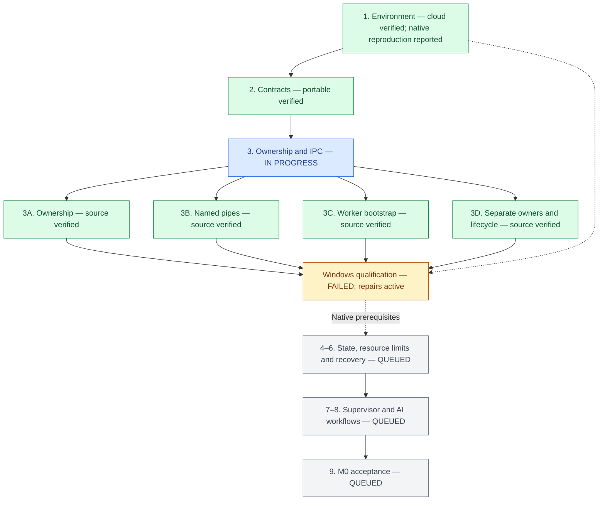

# Compertum

A supervised quant research system with reproducible experiments, bounded AI proposals and independent audits.

**M0 foundations: in progress.** Latest source stage: **Task 3D**, with native-verification repairs in progress. Updated **8 October 2026 (ET)**.

## Build tracker

Green means the stated **cloud, portable or source checks** passed. It does not mean Windows acceptance passed. Blue is current work; amber is pending verification or implementation; gray is queued. The diagram groups later tasks; the [implementation plan](docs/M0_IMPLEMENTATION_PLAN.md) defines their exact prerequisites.

| Task | Progress | Completed work / remaining gate |
| --- | --- | --- |
| 1. Environment | Cloud verified; native reproduction reported | Windows operator reports Python 3.14.7 and two clean reproductions of 39 distributions. Full raw evidence review remains pending. |
| 2. Contracts and configuration | Portable verified | Immutable records, five strict schemas, fixed budgets and capability checks. |
| 3. Ownership and IPC | **In progress** | Ownership, named pipes, scoped worker bootstrap and separate-owner registration source verified. Native qualification and later durable replay integration remain. |
| 4. State and durable events | Unpublished source work | Initial portable checks pass; three source-review findings remain. Native Task 3 repair takes priority. |
| 5. Resource and storage controls | Queued | Native process limits, byte reservations and storage watchdog. |
| 6. Recovery sets | Queued | Consistent snapshots and rollback-safe restore. |
| 7. Supervisor and terminal flow | Queued | M0 commands and durable offline task lifecycle. |
| 8. AI proposal workflows | Queued | Manual bridge and bounded local-model qualification. |
| 9. M0 verification | Queued | Full clean rerun, independent review and acceptance evidence. |

## Latest verified checkpoint

| Check | Task 3D result |
| --- | --- |
| Cloud source suite | **201 passed**, zero failures |
| Installed-package checks | **183 passed**, zero skips |
| Native Windows fixtures | **53 skipped — UNVERIFIED** |
| Independent source review | Completed; two important findings fixed with regression checks |
| M0 acceptance | **Incomplete** |

Current focus: repair the failures from the first Windows run. The operator reports **28 passed / 25 failed** native fixtures and **0 passed / 11 failed** in a fresh registration rerun at `68f9643`. Native Task 3 and M0 remain incomplete. The [native repair report](reports/M0_NATIVE_REPAIRS.md) separates reported Windows measurements from cloud checks and lists the unresolved DACL/cancellation investigations. No runtime effects or paper trading are enabled.

Repair candidate cloud checks: **203 passed / 54 Windows skips**. The longest collected test ID is now **140 characters**. Direct-runtime launching and virtual-environment preservation still require a native rerun.

Evidence: [Environment](reports/M0_BOOTSTRAP.md) · [Contracts](reports/M0_TASK2.md) · [Ownership](reports/M0_TASK3A.md) · [Named pipes](reports/M0_TASK3B.md) · [Worker bootstrap](reports/M0_TASK3C.md) · [Separate owners and lifecycle](reports/M0_TASK3D.md).

This tracker is updated with each completed source stage, verification result or changed blocker. Detailed specifications and operating instructions live in [the build specification](docs/BUILD_SPEC.md) and [the verification handoff](docs/WINDOWS_HANDOFF.md).
