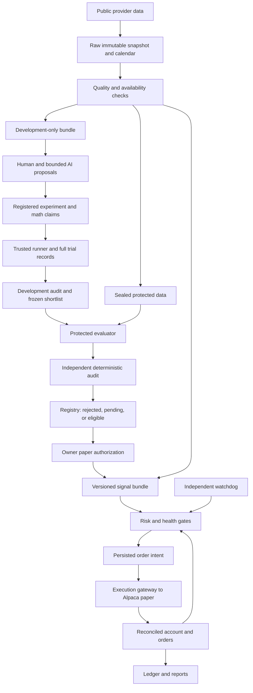

# Supervised solo quant build specification

Specification version: 1.1. Initial setup inspection and documentation revision date: 7 October 2026 Eastern. Status: proposed implementation contract, with previously verified setup evidence. Revision 1.1 resolves timing, scoring, covariance, closing, recovery, ownership and resource-enforcement review findings. It does not refresh hardware/provider observations. This document does not authorize implementation, credentials access, brokerage actions, purchases, publishing, or live trading. The M0-only execution plan is `docs/M0_IMPLEMENTATION_PLAN.md`; its existence is not implementation authority.

Starting requirements: `Solo_Quant_System_Build_Preparation.md`, SHA-256 `668c66e3e6122b948db6beb679df96c16d0e753e5962daefd4dd4fb1e6fe641c`. The preparation brief is dated 8 October; inspection occurred on 7 October. The user's current instructions take precedence over its draft allocations and open-ended suggestions.

## Resource amendment - 16 October 2026

The owner authorized workload-based timer and temporary-space changes. Complete storage scans now have 30 seconds, completed inventories expire after 35 seconds, and scans yield to heartbeat work. Recovery has a shared 240-second deadline; authenticated commands allow 300 seconds while authentication and reply acknowledgements retain five seconds. The scratch category is 10 GiB under the unchanged 50 GiB aggregate cap. The current verification namespace has a 4 GiB bound, including three fully allocated native reserve fixtures. The actual 1 GiB emergency reserve, CPU/RAM limits and disk-free floors remain unchanged. Strata stays off. See [measurements, rationale and capacity research](../reports/RESOURCE_TIMERS_AND_STORAGE.md).

Later on 16 October, the owner approved a 21 GiB backup ceiling under the unchanged 50 GiB total.
The complete metadata census confirmed only 522,272 bytes remained under the previous 20 GiB ceiling.
This decision permits no evidence removal, reserve borrowing or other category increase.

Later on 16 October, the owner approved 11 GiB scratch, then 12 GiB scratch to preserve a failed native fixture.
The current scratch ceiling is 12 GiB. Backups stay 21 GiB and the total stays 50 GiB.
The original 1 GiB emergency reserve remains fully allocated and protected.
Both native fixture reserves and all failed evidence remain preserved.
No timer, memory, CPU, financial or broker-authority limit changed with these allocations.

On 17 October, the owner approved 14 GiB test scratch for one fresh native test folder.
Backups remain 21 GiB, and the aggregate remains 50 GiB. The test folder retains a 1072 MiB bound and one allocated GiB reserve.
This test-space approval does not revise published program limits or the frozen configuration of historical runtimes.
All operating, financial, memory, CPU, and deadline gates remain unchanged.

Later on 17 October, the owner approved 15 GiB test scratch for one additional 1072 MiB native folder.
Fresh complete admission passed before that folder was created. Backups remain 21 GiB; total storage remains 50 GiB.
This test-only approval preserves published program limits, historical runtimes, allocated reserves, and all other operating gates.

## Test retention amendment - 19 October 2026

The owner approved `docs/TEST_RETENTION.md` for routine cleanup of verified disposable test files.
It replaces blanket preservation of those files. Keep results, unresolved failure evidence, and real runtime data.
The 50 GiB total and existing category limits remain unchanged.
Historical preservation statements above describe the authority at those dates.

## 1. Requirement status and scope

Use these labels throughout implementation receipts:

- **Required** means supplied by the user and binding.
- **Verified** means observed in this inspection, or established by the cited public documentation. Public entitlement documentation does not verify this user's account.
- **Default** means a concrete proposal for implementation. Changes require a versioned decision before the affected experiment or paper session.
- **Pending** means a specific later verification or decision, with the gate it blocks stated explicitly.

Required: native Windows 11; Ryzen 7 7700X; RTX 5070 Ti; 64 GB DDR5; plan within 1 TB total storage. New spending is $0. Approximately $300/month is reserve, never an automatic allocation or spending target. Prioritize the existing OpenAI Pro 20x access through March 2027. No API credits are assumed. Use Strata's Qwen3.8-Flash family as the verified local backup. Start with Alpaca paper trading and free stock data. Compare daily, weekly, and monthly candidates under fixed protected evaluation. Include bounded ML, a mathematician, independent audits, risk controls, and terminal controls.

Default: one local repository named Compertum, one supervised desktop, daily-bar stock features, long-only whole-share positions, no leverage, no shorting, no derivatives, and no automatic horizon switching. No external repository or cloud service is needed. Live allocation remains zero. Local scheduling must not change Windows power settings or create an unattended service without a separate operating decision.

The first end-to-end deliverable includes a data snapshot, deterministic baseline, bounded ML comparison, mathematical review, protected evaluation, independent audit, and controlled paper operation. Implement it in the milestones in section 16. AVO-style search, DREAM replay, neural model training, automatic self-modification, distributed services, live trading, and subscription renewal decisions are outside version 1.

Engineering completion and strategy acceptance are separate records. Valid outcomes include `ENGINEERING_READY / NO_CANDIDATE_QUALIFIES` and `ENGINEERING_READY / STRATEGY_EVIDENCE_PENDING`. Neither is permission to relax a test or start live trading.

## 2. Verified setup and missing capabilities

The project initially contained only the preparation brief. `git rev-parse --show-toplevel` reports that this folder is not a Git repository. No product implementation, project environment, dependency lock, data snapshot, paper integration, or project tests existed at inspection.

| Item | Verified observation | Implementation implication |
| --- | --- | --- |
| Shell | PowerShell 7.6.1, Core, Win32NT | Use native PowerShell examples and Windows paths. |
| OS | Kernel/build `10.0.26300`; registry display version `26H2`, UBR `9550`; registry ProductName says `Windows 10 Home` | Windows 11 is a required supplied constraint. Registry branding alone does not settle edition. CIM OS inspection was denied; confirm edition later without elevation. |
| CPU | Registry reports AMD Ryzen 7 7700X 8-Core Processor | CPU matches supplied requirement. Thread count and sustained workload performance were not benchmarked. |
| RAM | Running Strata reports 62.9 GiB physical RAM, 53.5 GiB used at one snapshot | Consistent with 64 GB installed. DDR5 type/speed remain supplied, not independently verified. Available RAM is tight with the model resident. |
| GPU | `nvidia-smi`: RTX 5070 Ti, driver `617.42`, total `16303 MiB`; free `1210 MiB` at one snapshot | Native GPU inference works. No additional GPU workload while Strata occupies this memory. |
| CUDA | `nvcc`: CUDA Toolkit 13.4, compiler 13.4.59 | Installed compiler is not proof of PyTorch or training compatibility. |
| Python | `C:\Program Files\Python314\python.exe`, Python 3.14.7; `py -0p` lists only this interpreter; SQLite 3.50.4 | Propose a fresh project environment using 3.14.7. Wheel compatibility is an M0 gate. |
| Global packages | NumPy, pandas, SciPy, scikit-learn, PyTorch, SymPy, HTTPX, pytest, and `alpaca` are not importable in the default interpreter | Project dependencies are missing there. Do not borrow or modify Strata's environment. |
| Git / uv | Git 2.55.0.windows.3; uv 0.12.1 | Executables exist. `uv python list --only-installed` could not access its cache under this sandbox; project environment creation was not tested. |
| Other tools | Node/npm and llama-server found; Ollama, Strata command alias absent from PATH | These are not required for the initial quant runner. |
| Storage | C: NTFS, 930.47 GiB capacity, 220.02 GiB free. D: NTFS, 930.42 GiB capacity, 535.39 GiB free | Two logical volumes differ from the supplied 1 TB total. Physical topology and allocation permission are unresolved. Default all new project files to C: within a 50 GiB cap. Do not assume D: is available for new writes. |
| Power | Balanced plan; AC sleep timeout 0 seconds, DC timeout 600 seconds | No AC idle sleep timer is configured. This does not prove the PC stays awake, online, or supervised. No settings changed. |
| Hardware inspection | CIM queries returned access denied | Safe registry, .NET, NVIDIA, and existing Strata telemetry supplied the narrower findings above. No elevation attempted. |
| Codex | CLI 0.160.1; `exec`, read-only sandbox, JSON events, stdin prompts, output schemas available in help | `codex login status` failed because the sandbox could not find the home directory. Independent CLI login, exact plan entitlement and remaining quota are unverified. No auth file or token was read. |

### Strata inspection and small capability checks

Verified existing process: `D:\Strata\engine\strata.exe`, about 36.83 GiB working set. Existing HTTP listener is `127.0.0.1:8080`. GET `/health`, `/v1/models`, and `/v1/status` agree on loaded model `qwen3.8-flash-next-iq2_xs`, engine `0.1.40.2`, 65,536 context positions, one serving slot, text input/output, and vision disabled. Health reports no API key requirement on this existing loopback service. No settings, model weights, or server lifecycle were changed.

Engine binary SHA-256: `04a4df56787080517addeed454c803eb6e189fc06804eb0a600481bf628f5ac2`. `D:\Strata\BUILD.json` reports release 0.1.40.2, CUDA 13.0 build, GPU architecture 120 among supported targets. This build metadata is distinct from the installed CUDA Toolkit version. Model-weight hashes, tokenizer hash, full effective sampling/template configuration, and cancellation behavior still need M0 verification.

Three sequential requests used POST `/v1/chat/completions`, the exact model ID above, `temperature=0`, `reasoning_effort=none`, `stream=false`, 96 or 128 output tokens, and 20-second client timeouts. The server was idle before testing. No tools or MCP actions executed.

| Probe | Actual result | Observed request latency |
| --- | --- | --- |
| JSON arithmetic: result of 2+2 | `{"result":4}`, finish `stop`, 104 total reported tokens | 0.776 s |
| Domain check: sqrt of (-3) squared and general real identity | Value 3; universal `sqrt(x^2)=x` false; correct identity `sqrt(x^2)=abs(x)`, finish `stop`, 164 total tokens | 0.992 s |
| Forced fictional `read_fixture` call | One tool call with `{"symbol":"SPY","lookback":5}`, finish `tool_calls`, 345 total tokens | 1.355 s |

These are smoke checks, not a coding benchmark, long-context benchmark, proof certification, or full worker qualification. Source inspection shows structured output is `prompt_and_validate`, not constrained decoding. The existing Strata Python environment lacks `jsonschema`. It rejects Chat Completions `response_format` combined with tools/MCP. The project adapter must validate every response itself and use separate tool-call and final-JSON requests. Native inference success does not verify GPU ML training support. [Strata project](https://github.com/Niko1221/Strata).

## 3. Architecture, boundaries, and ownership

Default implementation stack: Python 3.14.7, stdlib argparse/TOML/SQLite/decimal, NumPy, pandas, SciPy, scikit-learn, SymPy, PyArrow, HTTPX, jsonschema, pytest, exchange_calendars, and tzdata. Resolve exact compatible versions once in M0, commit a hash-checked lock, and record actual versions. Do not invent pins before wheel verification. No PyTorch is needed for the initial ML experiments. If 3.14 wheels fail, document the failure and propose a free supported interpreter, normally 3.13; do not silently replace the interpreter or install during this specification task.

| Proposed module/process | Responsibility and public contract | Exclusive mutable ownership |
| --- | --- | --- |
| `compertum.domain` | Immutable typed records, units, states, schema validation; no provider I/O | None |
| `compertum.runtime` | Canonical project identity, singleton handles, process-generation registry, authenticated IPC and bounded worker launch | Role-registration metadata through its sole coordinator owner; no broker actions |
| `compertum.cli` | Parse commands, show status, confirm account actions, send typed requests | None; cannot write databases directly |
| `compertum.coordinator` | Queue tasks, leases, budgets, imports, research pause, experiment lifecycle | `state/research.sqlite` |
| `compertum.data` | Request allowlisted provider reads through credential transport, validate/version bars/actions/calendars, publish immutable manifests | Data snapshot staging/publication; data catalog via coordinator |
| `compertum.features` | Pure `features(snapshot, decision_times, feature_spec)` | Task-local output only |
| `compertum.experiments` | Trusted template runner, fit preprocessing/models, backtest, checkpoints | Its run directory, returned to coordinator |
| `compertum.evaluation` | Seal protocol, holdout access, one-shot scoring and selection checks | `state/evaluation.sqlite`, protected manifests/results |
| `compertum.math` | Claim packets and deterministic symbolic/numerical checks | Task-local claim artifacts |
| `compertum.audit` | Independently rerun and inspect evidence using a separate audit entry point | Audit artifacts, never approval state |
| `compertum.registry` | Check evidence prerequisites and owner approvals | Registry records written by coordinator; frozen bundles |
| `compertum.ai` | Manual subscription packets, optional qualified Codex adapter, Strata inference and schema validation | Provider receipts in its task directory |
| `compertum.risk` | Pure `check(intent, account_snapshot, limits, health)`; fixed reject reasons | None |
| `compertum.execution` | Pretrade checks, durable intents, paper requests, reconciliation; execution-owned credential transport for allowlisted data reads | `state/execution.sqlite`; sole broker writer and provider-credential holder |
| `compertum.watchdog` | Independent heartbeat, deadline, storage and suspension checks; trip local order gate | Its own health journal and restrictive halt file |
| `compertum.storage` | Serialized byte reservations and bounded artifact writes; recovery-set collection through owner checkpoint APIs | Reservation ledger through coordinator; each database retains its named owner |
| `compertum.reporting` | Read snapshots and report evidence, orders and performance | Generated reports only |

Domain records use `schema_version`, immutable IDs, UTC timestamps, and hashes. Required records include `TaskSpec`, `DatasetManifest`, `FeatureManifest`, `ExperimentSpec`, `RunResult`, `ClaimPacket`, `AuditResult`, `PromotionRecord`, `SignalBundle`, `OrderIntent`, `BrokerObservation`, and `ControlReceipt`. Money and quantities use decimal strings and explicit currency; analytical arrays use float64. Symbol identity includes provider asset ID and effective-date symbol mapping. No module outside execution receives order credentials or a broker-writing function. Alpaca's account key can also authorize data reads; do not mistake that key for a restricted data credential. Execution-owned credential transport admits only typed, allowlisted GET requests for the data module. It prioritizes reconciliation over ingestion, rate-limits each service independently, and never accepts a worker-supplied HTTP URL/method/body. The research-only mode may run this read-only transport without activating order submission.

Interface examples, to be implemented rather than executed now:

```text
submit_task(TaskSpec) -> task_id
publish_snapshot(DatasetManifest) -> dataset_id
execute(ExperimentSpec, development_bundle) -> RunResult
evaluate(sealed_protocol_id, frozen_candidate_ids) -> EvaluationReceipt
audit(run_id, immutable_manifest) -> AuditResult
approve_paper(candidate_id, evidence_hashes, owner_confirmation) -> PromotionRecord
plan_orders(SignalBundle, reconciled_account_snapshot) -> OrderIntent[]
execute_intent(OrderIntent, authorization_id) -> ControlReceipt
reconcile(account_alias, since_cursor) -> ReconciliationReceipt
```

Database schemas and record JSON schemas belong in `schemas/`; reject unknown schema versions and fields. Domain logic depends on domain types. Provider adapters translate HTTP responses into these types; evaluators and risk functions do not import the CLI, AI provider, or brokerage transport.

Alternative considered: one process owning everything. It reduces launch work but lets heavy research block reconciliation and lets a research crash stop monitoring. Alternative considered: distributed services/queues. They add deployment and shared-state complexity without a measured need. Choose local isolated research processes plus separate execution/watchdog processes and one writer per database.

### Complete data flow



Any missing quality, audit, authorization, or reconciliation receipt stops the affected transition. `NO_CANDIDATE_QUALIFIES` ends the campaign normally with retained artifacts. There is no direct AI-to-order route.

## 4. State, isolation, and permission rules

Research state: `RUNNING`, `PAUSE_REQUESTED`, `PAUSED`, `AI_UNAVAILABLE`, `RESOURCE_BLOCKED`, `STOPPED`. Order admission: `DISARMED`, `ARMED`, `HALTED`, `RECONCILING`. Cancellation/flattening operation state: `PLANNED`, `AUTHORIZED`, `SUBMITTING`, `PENDING`, `CONFIRMED`, `FAILED`, `UNKNOWN`. Halting admission does not change positions.

Run state: `REGISTERED -> QUEUED -> RUNNING | WAITING_FOR_OPERATOR -> COMPLETED | FAILED | TIMED_OUT | PAUSED | UNVERIFIED`. Candidate evidence state: `DEVELOPMENT_ONLY -> FROZEN -> EVALUATED -> AUDITED -> PAPER_ELIGIBLE | REJECTED | EVIDENCE_PENDING`. `STRATEGY_ACCEPTED` additionally requires the forward gate in section 10. Owner authorization is separate from either evidence state.

Research workers submit messages and artifacts through a validated dispatcher. They cannot mutate shared databases, risk limits, holdouts, registry approval, or broker state. Each attempt has its own directory. No worker has arbitrary shell, inherited environment secrets, unrestricted filesystem access, or an unrestricted network client. Initial executable experiments are trusted templates selected by validated configuration. Proposed source patches are quarantined artifacts and require human review, tests, and independent audit before a new trusted release. Do not execute arbitrary AI-generated Python as the desktop user.

Protected data are absent from worker bundles, prompts, retrieval tools, and logs. Evaluation and audit are trusted deterministic processes. Same-user Windows process separation alone is not a filesystem security boundary. An automatic Codex adapter is disabled until its effective read/tool permissions are proved against protected files. If that cannot be enforced without new OS/account permissions, use the manual subscription workflow and model-only Strata calls. Do not claim holdout isolation on the strength of a prompt instruction. The owner can deliberately access local files; any premature access to protected outcomes invalidates that evaluation receipt.

### Singleton startup and takeover

Resolve the project root by opening the directory and reading its final normalized Windows path and volume/file identity. Derive `project_id` from that identity, not user-supplied case/spelling or a junction alias. Reject an unexpected root identity. The startup supervisor and every mutable owner, including coordinator, evaluator, execution and watchdog, acquire their own `state/locks/ROLE.lock` using `CreateFileW`, `OPEN_ALWAYS`, read/write access and share mode zero. Hold the non-inheritable exclusive handle for the entire owner lifetime, before opening writable databases, publishing endpoints or enabling any credential transport. Never delete, rename or recreate an occupied lock file to take ownership. This filesystem handle also covers two Windows sessions targeting the same directory; a session-local named mutex alone does not. [Exclusive file handles](https://learn.microsoft.com/en-us/windows/win32/api/fileapi/nf-fileapi-createfilew), [Final path identity](https://learn.microsoft.com/en-us/windows/win32/api/fileapi/nf-fileapi-getfinalpathnamebyhandlew).

Under that handle publish atomically readable role metadata containing project ID, role, process-instance UUID, PID, Windows process creation time, operator SID, endpoint, generation and code hash. A second terminal authenticates and attaches to the existing healthy supervisor; it does not launch another execution owner. Contended/uncertain startup returns an explicit `OWNER_BUSY` or `OWNER_UNVERIFIED` receipt, not success. An access-denied or wrong-root result fails closed.

A missing heartbeat or stale metadata never authorizes takeover. Verify the prior process identity using PID plus creation time. A retained matching process handle signaling exit proves that instance ended. After final handle reclamation or reboot, permit a separate `VERIFIED_ABSENT` path only after exclusive role-handle acquisition: Windows must explicitly report that PID nonexistent and a successful native process snapshot confirm absence, or an accessible process at the reused PID must have a different verified creation time. This proves the old instance ended; it does not authenticate, attach to or terminate the unrelated reused-PID process. Access denied, failed enumeration or ambiguous identity is not absence and blocks takeover. A still-live matching instance blocks replacement even if its lock/heartbeat was lost. Never require reopening a process object that the OS has already reclaimed. A dead owner thread does not establish process death; if a mutex is also used as a fast-path, `WAIT_ABANDONED` is insufficient. Release transport authority/endpoints before releasing handles; unexpected handle loss trips the owner's gate and exits. [Process identity](https://learn.microsoft.com/en-us/windows/win32/api/processthreadsapi/nf-processthreadsapi-getprocesstimes), [Wait semantics](https://learn.microsoft.com/en-us/windows/win32/api/synchapi/nf-synchapi-waitforsingleobject), [Native process snapshots](https://learn.microsoft.com/en-us/windows/win32/toolhelp/taking-a-snapshot-and-viewing-processes).

After proved exit and exclusive reacquisition, generate a new process-instance UUID and role generation, expire old task leases and IPC capabilities, and invalidate all paper arms/plans. Execution starts `RECONCILING` with admission halted, then `DISARMED` only after recovery; never carry an armed state across takeover. The same recovered intent/client IDs remain in force. No takeover code replays order POSTs. Simultaneous startup, path aliases, live-process/dead-thread cases and restart overlap must demonstrate one execution owner at every observed instant.

### IPC role authentication

Use local named pipes with `PIPE_REJECT_REMOTE_CLIENTS`, an explicit DACL for the operator SID and permitted logon SID, and deliberately limited client rights. Do not use default Everyone/anonymous access or client rights that permit creating server instances. The first owner uses `FILE_FLAG_FIRST_PIPE_INSTANCE`; an unexpected occupied pipe is a failure, not a trusted endpoint. Both peers verify the OS-reported peer PID, creation time and SID against the live registered process instance before accepting a command. Caller-supplied PID/SID/role strings are never identity evidence. [Pipe access rights](https://learn.microsoft.com/en-us/windows/win32/ipc/named-pipe-security-and-access-rights), [Pipe creation](https://learn.microsoft.com/en-us/windows/win32/api/namedpipeapi/nf-namedpipeapi-createnamedpipew), [Client PID](https://learn.microsoft.com/en-us/windows/win32/api/winbase/nf-winbase-getnamedpipeclientprocessid), [Server PID](https://learn.microsoft.com/en-us/windows/win32/api/winbase/nf-winbase-getnamedpipeserverprocessid).

The supervisor registers child role, project and generation and gives that process a scoped random handshake capability through a private inherited bootstrap pipe. The capability is absent from command lines, persistent metadata and logs, and expires on restart. Its rights are an explicit command allowlist. A CLI has operator-control rights, not a writer-role capability; a worker cannot claim execution/watchdog/evaluator rights. Reject wrong role, generation, peer instance or unregistered child. For a repeated request ID, an identical canonical action/payload hash from the same authenticated subject to the same target generation returns its durable existing receipt without another effect. A changed payload, subject or target generation is rejected. Operator subject identity is the verified SID/control scope; worker subject identity additionally binds process instance/role/generation. A replacement CLI process still authenticates its own OS identity before reading an operator receipt. Authenticate responses too. Role checks enforce the application protocol, not hostile same-user process isolation.

Watchdog can only create a halt flag or request a restrictive state transition; only execution plus an explicit operator command can clear it. Execution checks the flag immediately before each action: it denies automatic strategy submissions, while separately authorized cancellation/closing uses the risk-reducing predicate in section 13. Every action still requires valid owner generation and durable journaling. An execution crash leaves admission halted/disarmed on restart.

## 5. Terminal command contract

The following are future product commands, not existing commands or instructions executed during this task. Run from the project root using `.\.venv\Scripts\python.exe` as shown below. IDs such as `RUN_ID` are placeholders for IDs returned by commands. All commands support `--json`; default output is concise text with evidence status.

```powershell
.\.venv\Scripts\python.exe -m compertum status
```

| Exact command suffix after `-m compertum` | Effect and required receipt |
| --- | --- |
| `doctor --read-only` | Check tools, environment, storage, provider reachability, permitted account status. No installation, login, order, setting change or secret output. |
| `start --mode research --config config/default.toml` | Start coordinator and watchdog; order admission remains disarmed. Starting does not authorize brokerage writes. |
| `start --mode supervised-paper --config config/default.toml` | Start coordinator, execution and independent watchdog disarmed. Require existing authorized credential provisioning; do not initiate login or settings changes. Watchdog monitors only roles declared active by the chosen mode. |
| `status` | Show run/campaign IDs, research/order states, AI availability, data age, reconciliation age, process heartbeats, budgets and last incident. Never infer an effect from command submission alone. |
| `research run --protocol protocol-v1 --campaign CAMPAIGN_ID` | Register and execute the predeclared bounded development campaign. Does not expose holdout or arm orders. |
| `research freeze --campaign CAMPAIGN_ID` | Apply the fixed selection rule, hash candidate bundles and write a frozen shortlist with its returned artifact path. No protected-data access. |
| `research pause --reason operator` | Stop new research dispatch immediately; checkpoint active trusted work at the next boundary within 30 s; stop AI generation requests. Preserve artifacts. Execution and monitoring continue. |
| `research resume` | Resume admitted tasks only after budgets/health check. No order state change; no automatic retry of an uncertain side effect. |
| `research stop --run RUN_ID` | Cancel one research run, checkpoint if possible, mark incomplete evidence, stop its process tree within 30 s. Never cancel orders or close holdings. |
| `ai status` | Show usable provider/capability status and evidence dates; unknown subscription quota displays `UNKNOWN`. |
| `ai export --task TASK_ID --provider subscription` | Write a sanitized prompt packet to the task directory for the operator's existing ChatGPT/Codex session. No AI request or account action. |
| `ai import --task TASK_ID --response artifacts/inbox/response.json` | Validate response schema, provenance declaration and permissions; retain original response; record proposal. Invalid content cannot execute. |
| `ai qualify --provider strata --suite worker-v1` | Run the bounded local model-only capability suite, no actual tool effects. Results do not approve a strategy. |
| `foundation check --suite m0 --offline` | Execute the registered bounded local fixture through M0 state/resource/restart controls, with no AI request, broker, market data or financial score. Publish a foundation receipt, never strategy acceptance. |
| `data fetch --profile free-iex --start 2016-01-01 --end 2025-12-31` | After authorized credential setup, read provider data with explicit feed/adjustments, paginate and publish a new snapshot. Never replace an existing snapshot. |
| `evaluate seal --protocol config/protocol-v1.toml` | Validate and hash protocol/splits/trial ceiling/universe/costs, create a seal before runs. Worker changes cannot overwrite it. |
| `evaluate final --seal SEAL_ID --shortlist artifacts/SHORTLIST_ID.json` | One protected batch for the sealed, frozen shortlist. Record consumption before access; do not expose detailed feedback to workers. Refuse repeat use. |
| `audit run --run RUN_ID` | Run independent evidence checks and a clean-environment rerun. No promotion or order effects. |
| `registry approve-paper --candidate CANDIDATE_ID --evidence AUDIT_ID` | Require interactive owner confirmation of exact version, account alias and evidence status; record scoped approval. Cannot override failed strategy gates. |
| `paper reconcile --account paper-primary` | Broker reads only; compare orders/fills/positions/cash/actions to durable intents and ledger. Unresolved differences keep admission halted. |
| `paper arm --account paper-primary --candidate CANDIDATE_ID --until-close` | Require recorded owner approval and typed confirmation; arm only this candidate/session after all gates. Arming never submits an order by itself. |
| `paper fixture prepare --account paper-primary --symbol SYMBOL --qty 1 --max-notional 250` | Create an audited engineering-only fixture ID. Verify the same data, quantity, cash and health rules. It cannot enter the strategy registry or bypass hard risk limits. |
| `paper fixture arm --fixture FIXTURE_ID --until-close` | Typed owner confirmation for this small engineering session, separate from strategy authorization. No automatic buy. |
| `paper fixture buy --fixture FIXTURE_ID --plan` | Create a hashed one-share market-buy plan under the fixture's total $250 cap. No broker write. |
| `paper fixture buy --fixture FIXTURE_ID --execute PLAN_ID` | Confirm and execute only that plan through the intent journal and execution gateway. |
| `paper fixture resting-buy --fixture FIXTURE_ID --limit-discount 0.20 --plan` | Plan one engineering-only DAY limit order 20% below the reference, rounded down to the verified tick. Project existing holdings plus possible fill against the same total cap. |
| `paper fixture resting-buy --fixture FIXTURE_ID --execute PLAN_ID` | Confirm and submit only the reviewed limit-order plan; record any actual fill. This is not a production strategy order type. |
| `orders halt --reason operator` | Persistently stop all new strategy orders before acknowledging. Holdings and outstanding orders remain. Continue risk checks, reconciliation and explicit incident controls. |
| `orders resume --account paper-primary` | Explicit typed operator action; require fresh reconciliation, eligible data and all hard gates. Clear only the resolved halt to `DISARMED`; require explicit paper/fixture arm afterward. Cannot clear a continuing failure or restore yesterday's authorization. |
| `orders cancel --account paper-primary --scope system --plan` | Read current open system orders and write a hashed cancellation plan. Does not contact a broker-writing endpoint. |
| `orders cancel --account paper-primary --scope system --execute PLAN_ID` | Typed confirmation of exact plan/account; halt new orders first; request cancellation of listed orders. `PENDING` until terminal broker status confirmed; partial fills become positions. |
| `positions close --account paper-primary --scope system --plan` | Halt admission, reconcile and produce a cancellation/close plan containing a finite list of bounded child intents, quantities, per-child caps and deadline under sections 13-14. No broker writes. |
| `positions close --account paper-primary --scope system --execute PLAN_ID` | Typed confirmation; cancel/reconcile conflicting orders, then submit authorized risk-reducing children while strategy admission stays halted. Complete only when broker confirms flat positions and no conflicting orders; blocked residuals remain explicit. |
| `incident status --id INCIDENT_ID` | Show uncertainty, affected intents, observations and safe next reconciliation action. |
| `shutdown --checkpoint` | Pause research, persist order halt, checkpoint and stop local processes. Does not cancel broker orders or flatten holdings. Refuse a clean/confirmed shutdown receipt if required persistence fails. |

No live-account flag, generic broker DELETE tool, unscoped liquidation, or `--force` gate bypass is part of version 1. System scope means orders with recorded Compertum intent IDs and positions whose full quantity has reconciled ownership. Foreign orders/holdings halt admission and require operator resolution; do not cancel or liquidate them automatically. The controlled walkthrough requires a verified clean paper account, without resetting it.

Paper actions are separately authorized at their point of use. Plans expire after 60 seconds before execution starts and are invalid if their bound account/orders/positions changed; regenerate before execution. An accepted operation then runs within its own deadline. If cancellation produces additional fills or a different close quantity, stop and generate a new close plan rather than enlarge the authorization. Do not offer a generic `--yes` shortcut for these actions. Read-only commands may run while disarmed. Once authorization exists for a plan, execute its bounded steps without repeatedly asking for the same approval. Fixture authorization is an explicit separate record type; failed financial gates can never yield a strategy promotion by using fixture commands.

Exit codes: 0 confirmed requested effect or successful read; 2 invalid input/state; 3 missing authority/capability; 4 blocked health/risk/data/evidence; 5 external result uncertain; 6 internal failure. A queued cancellation or close returns its operation ID and exit 5 until observed complete, never a false success. A watchdog-triggered halt needs no AI or owner response.

## 6. Worker contracts and resource budgets

Every `TaskSpec` contains task/parent/campaign IDs, role, immutable input hashes, expected output schema, admitted tools, filesystem bundle, network destinations, deadline, CPU/RAM/GPU/disk limits, maximum attempts, model identity, and acceptance checks. Coordinator grants a lease and owns its renewal. No task can increase its own budget. Automatic task limits count active elapsed time, including network waits and retries. Manual subscription waiting is a separate `WAITING_FOR_OPERATOR` state with a 24-hour receipt deadline, no process lease and no CPU reservation; after that deadline, record a timed-out attempt. Time spent in this state does not consume the automatic task clock. External manual inference duration/usage is unknown unless actually supplied; label it unverified rather than claim a measured budget. Imported proposals still consume the task/request allowance and cannot evade experiment trial limits.

| Worker | Inputs and required outputs | Permissions | Default task limit |
| --- | --- | --- | --- |
| Research proposer | Development summaries, baseline and fixed protocol -> hypothesis, feature/model spec, citations, falsifier and trial ID | Read sanitized development bundle; approved public literature through coordinator; write own proposal | 20 min wall time; 2 attempts total; 8 AI requests total |
| ML planner | Defined target/features/training splits/template choices -> validated experiment configuration and predictive/trading scorecard plan | Same read boundary; no training or order tools | 20 min; 2 attempts; 8 AI requests |
| Experiment runner | Frozen approved config/code/data -> metrics, model, predictions, fills, logs, checkpoint and manifest | Trusted code only; no network or broker credentials; task-local writes | 30 min; 2 attempts for transient infrastructure failure, no automatic parameter retry; 4 CPU threads, 4 GiB RAM, 2 GiB output; no GPU |
| Mathematician | Bounded claim, assumptions, baseline and test contract -> complete `ClaimPacket` | Development and public literature only; no final data, approvals, shell or broker | 30 min; 2 attempts; 10 AI requests |
| Independent mathematical checker | Claim statement and artifacts -> proof/assumption objections, counterexamples, verified numerical/symbolic checks | Read claim; trusted check templates; no self-approval; new context if AI critique used | 20 min; 2 attempts; 4 CPU threads, 2 GiB RAM; no GPU |
| Independent experiment auditor | Frozen manifests and raw run outputs -> audit pass/fail/unverified, discrepancies and independent rerun | Trusted audit process; protected reads only after consumption, for a scoped audit of that evaluation; no candidate editing or promotion | 45 min; 2 attempts; 4 threads, 4 GiB RAM, 2 GiB output; no GPU |
| Protected evaluator | Sealed protocol, immutable snapshots, frozen shortlist -> evaluation receipt and restricted scorecards | Exclusive protected-data reader before consumption; no AI/network; results to registry/operator only | 45 min; one evaluation transaction; restart recovery as section 10, no new scoring choice; 4 threads, 4 GiB RAM |
| Coordinator | Requests and receipts -> queue/state/budget events | Sole research DB writer; no broker keys | Continuous; heartbeat 5 s; task leases 30 s; aggregate budgets below |
| Execution gateway | Authorized bundle + reconciled account -> intent, risk and broker receipts | Sole paper broker writer; secrets only in this process | Continuous during approved session; network deadlines and retry rules in section 14 |
| Watchdog | Health/data/order deadlines -> heartbeat or persistent halt/incident | Read status, write only its journal/halt flag; no broker or AI call | Heartbeat 5 s; trip after 15 s missing execution heartbeat |

Owner amendment, 12 October 2026: the owner rejected the proposed daily two-hour research runtime cap and explicitly removed it. Elapsed usage remains recorded; each job still has its own deadline and resource limits. This amendment supersedes the earlier daily allocation.

Initial aggregate research allowance: one heavy deterministic job or one local inference request at a time, 4 CPU threads, 4 GiB research RAM, no daily CPU-job wall-time cap, 8 AI tasks and 40 AI requests per day. Task requests above include all retries and fallbacks; exhaustion pauses the task. Set BLAS thread limits in child environments. Monitoring/execution have reserved capacity and higher scheduling priority.

Job Objects enforce process-tree ownership, committed-memory limits and CPU allocation, not filesystem occupancy. Launch a research child suspended, assign it to the verified job before resume, prohibit breakaway, use kill-on-job-close, and verify assignment. Restrict the job to at most four logical processors and the admitted committed-memory ceiling; the supervisor separately enforces wall deadlines and records/terminates the tree on violations. Failed assignment, unsupported limits or escape attempts leave the task unstarted. Existing Strata remains an external shared service and is never terminated or reconfigured as a research child. [Windows Job Objects](https://learn.microsoft.com/en-us/windows/win32/procthread/job-objects).

Proposal/AI adapter processes use one CPU thread and at most 256 MiB each; their local inference cost is the single shared Strata slot under the request limits below. Coordinator uses at most 256 MiB, execution/credential transport 512 MiB, watchdog 128 MiB. Data ingestion streams bounded pages with one CPU thread, at most 1 GiB RAM and the data storage cap; a report process uses at most 512 MiB and 500 MiB per report. These processes cannot raise worker limits. Hardware/resource telemetry is measured, never inferred from token speed. A budget violation creates an incident and pauses the affected task rather than starving execution.

Strata is already resident at approximately 53.5/62.9 GiB system RAM usage. Require at least 8 GiB available physical RAM before a 4 GiB research job; below 6 GiB, pause research dispatch and create a resource incident. Strata adapter uses one request, at most 16,384 input tokens and 2,048 output tokens, 120-second task request deadline. Abort if capacity would exceed the actual 65,536-token limit. Token counting must use the pinned local tokenizer or a verified conservative bound. No GPU training is admitted in version 1; later GPU experiments require a measured free-VRAM gate and separate protocol.

Project storage cap is 50 GiB: at most 15 GiB data, 5 GiB quant model artifacts, 10 GiB scratch, 5 GiB records/logs/code, and 21 GiB local backups. Existing Strata weights remain external read-only dependencies and are not copied into the project. Require at least 100 GiB C: free before large ingestion and at least 50 GiB free during operation. Stop research writes first under pressure, preserve execution journal space, and halt order admission if durable journaling is threatened. Never auto-delete trial evidence to continue research.

### Filesystem enforcement and journal capacity

The coordinator serializes durable byte reservations before dispatch or publication. Admit a write only if used bytes plus outstanding reservations plus its bounded growth fit task, category and total caps and the free-space policy. Account for staging files, copies awaiting rename, incomplete artifacts, logs, SQLite database/WAL/SHM, recovery manifests and backup blobs. Retain charged bytes after failed attempts until explicit cleanup; crash recovery recounts existing paths and outstanding reservations before new grants. Publication transfers a reservation to immutable retained usage; it does not double-count the same renamed file. Workers never own the shared reservation ledger.

Approved templates write through metered artifact sinks. Reserve the maximum output size first, check the remaining reservation before every write, and accept chunks no larger than 8 MiB. Reject a crossing chunk before writing it; stdout/stderr together are capped at 10 MiB per attempt inside that attempt's output budget. Stream provider pages and library serializers into bounded sinks; no unmetered temp directory or direct worker path writer is admitted. Exhausted output capacity checkpoints/stops the research job and records the failure, never publishes a partial success. This is application enforcement over trusted templates, not an OS disk quota or a guarantee against unrelated software filling C:.

Independent watchdog checks actual volume free bytes every second and compares reservation/accounting totals to actual allocated project files using cooperative complete scans bounded at 30 seconds, with completed observations expiring after 35 seconds, including unexpected files, reparse points and growth by processes outside the artifact API. Reject output paths outside the canonical workspace. Discrepancy or disk growth trips research/storage admission; if a writer continues after refusal, terminate that research job tree. Physical use may exceed logical payload bytes; charge measured allocations when larger. Watchdog reports its last successful measurement time; stale storage monitoring blocks dispatch.

Within the existing 5 GiB records/logs/code category, reserve 1 GiB for execution durability using a verified fully allocated, non-sparse `state/execution-reserve.bin`. Research/data/model/backup allocations cannot borrow it. Stop research when the 50 GiB free-volume floor or a category cap is reached. If critical journal writes need headroom, execution alone may release the reserve in recorded 64 MiB portions for durable halt/reconciliation receipts; this never authorizes new exposure. At less than 256 MiB unused reserve, failed free-space verification or failed journal flush, refuse further broker submissions including closing until durable recording capacity is restored. Closing while halted remains possible only when its own bounded journal reservation and all section 13 checks pass. Do not delete evidence to refill the reserve. If the reserve cannot be allocated/verified, execution capability remains unavailable.

## 7. Persistent records and reproducibility

Proposed paths, all under this project unless a later explicit storage/backup decision changes them:

```text
config/default.toml                  non-secret operational settings
config/protocol-v1.toml              evaluation, universe, features, risk and costs
schemas/                            record and response schemas
state/research.sqlite                tasks, trials, registry and control receipts
state/evaluation.sqlite              seals, access receipts and evaluation consumption
state/evaluation-consumption/        append-only access guard excluded from rollback
state/execution.sqlite               intents, observations, fills and reconciliation
state/execution-reserve.bin          execution-only 1 GiB allocated journal headroom
state/locks/                         exclusive owner/startup/recovery handles
state/runtime/                       process instances, generations and status metadata
state/watchdog/                      independent heartbeats, incidents and halt flag
data/raw/DATASET_ID/                 original response bodies, request metadata and hashes
data/normalized/DATASET_ID/          validated float64/decimal tables and manifests
data/development/BUNDLE_ID/          development-only worker input
data/protected/SEAL_ID/              protected data with access policy and checksums
artifacts/runs/RUN_ID/attempt-001/    code, config, checkpoints, models, predictions and logs
artifacts/claims/CLAIM_ID/            statements, derivations, counterexamples and checks
artifacts/audits/AUDIT_ID/            independent commands, outputs and discrepancies
artifacts/evaluations/EVALUATION_ID/  restricted final results
artifacts/paper/SESSION_ID/           signal bundles, risk and operation receipts
artifacts/ai/TASK_ID/                 sanitized prompts, responses and provider metadata
artifacts/inbox/                     operator-supplied proposals awaiting validation
reports/                            engineering, campaign and paper readouts
backups/                            local consistent backups, not disaster recovery
```

IDs use UUIDv7 or an equivalent time-sortable collision-resistant UUID, with explicit record type. Data/model/code IDs additionally identify SHA-256 content. Candidate ID hashes hypothesis, feature/target/portfolio definitions, model parameters, seed, code and data identities. A materially changed rerun is a new candidate/trial; a retry keeps the trial with a new attempt ID. Register before running, including expected resources and every searched variant. Failures, invalid configurations, interruptions, negative results and abandoned proposals remain in trial history.

Run manifests contain parent lineage, Git commit plus dirty patch/hash, complete source bundle, Python/dependency lock and wheel hashes, OS/build/CPU/GPU/driver, code/data/model/tokenizer/template hashes, feeds/adjustments/vintages/calendar, protocol and risk hashes, resolved configuration, seeds, timestamps, exact commands, exit codes, stdout/stderr, resource use, artifact hashes and audit references. No secrets, credentials, private account identifiers, or auth-bearing HTTP headers enter these records. Use local account aliases. Redact exceptions before persistence, without discarding HTTP status/request correlation metadata.

Default seeds: campaign 1729; model 1730; bootstrap 1731; counterexample tests 1732. Record all library RNGs. AI temperature zero is not a determinism guarantee; preserve responses and sampling settings. Deterministic CPU calculations use float64 and stable symbol/time ordering. Required exact matches: hashes, input rows, splits, order intent IDs, trade decisions and integer quantities. Scalar/array numerical tolerance is `atol=1e-10, rtol=1e-8`; portfolio return difference at most `1e-8` absolute per day. Use Decimal precision 28 for ledger arithmetic, preserve provider price precision, and round dollar reporting half-up to cents; round purchases and limit prices down to admitted share/tick units. Fees use the dated provider schedule's declared rounding. Numeric ambiguity within `1e-10` of a signal/risk boundary causes rejection or cash, not a different trade chosen by rounding. Changing tolerances after a failed rerun invalidates that comparison.

Write artifacts to task-local temporary names, flush, hash, then atomically rename on the same volume and publish a complete manifest. SQLite uses WAL, `synchronous=FULL`, foreign keys, transactions and unique constraints; only its named owner writes each DB. Cross-database messages carry stable event IDs and durable outbox/inbox receipts; receivers deduplicate. Brokers are never inside a DB transaction. Checkpoints at each completed fold and each model fit contain input/config hashes, last completed unit, RNG state and partial artifact hashes. Resume only matching immutable inputs/code; otherwise create a new run.

After a crash, expire task leases, mark interrupted attempts, verify checksums, resume only trusted checkpoint units, and never infer success from an artifact filename. A final evaluation marks consumption before reading holdout, persists progress, and may continue the same transaction from its checkpoint. If the evaluator revealed results before losing its recoverable state, mark `EVALUATION_COMPROMISED`; do not grant a fresh final query.

Retention: keep all manifests, trial/evaluation/audit/control/order records and small logs permanently within the project budget; pin accepted/provisional model bundles and every dataset needed to rerun a scored experiment. Large scratch files may be proposed for removal after 30 days, but deletion requires owner approval and cannot remove scored evidence. Local consistent backups run after supervised sessions, retaining 7 daily and 4 weekly manifests plus separately copied, content-addressed blobs. Each immutable blob is copied once into the backup store, not repeated in eleven complete directory copies. Database snapshots use SQLite's consistent backup API. Verify hashes and a restore within the 21 GiB backup cap; inadequate capacity pauses new research evidence rather than silently dropping required history. Local backups share the desktop's failure domain. Independent backup location/capacity is pending; unattended paper operation remains disabled until a recoverable backup is verified. Secrets are never included in backups.

### Recovery-set manifest and restore protocol

A `RecoveryManifest` is one consistent recovery set, not three unrelated database copies. It includes schema/recovery-set/project IDs; creation timestamp; code/environment/config hashes; each writer's process instance/generation; each DB snapshot/hash/schema/checkpoint ID; durable outbox event high-water marks, inbox acknowledgement high-water marks and full pending-message/deduplication identities; task/run/checkpoint states; all referenced artifact IDs, paths, lengths and hashes; seal/evaluation IDs and consumption states; consumption-guard head/hash; halt state and reserve accounting. Pin the transitive artifact closure before publication. Missing or corrupt referenced content makes the set incomplete.

Acquire an exclusive recovery-operation handle. Pause new dispatch and broker admission, ask all named writers to finish their local transaction and acknowledge a shared barrier, and suspend cross-DB message delivery. An in-flight broker uncertainty is recorded as uncertainty, not erased to obtain a clean checkpoint. Each owner creates its consistent SQLite snapshot and durable pending-message export at that barrier. Verify all snapshots, cross-DB event/ack relationships, artifacts and hashes, then atomically publish the complete recovery manifest. If any writer fails or the barrier expires after 30 s, retain an unpublished/incomplete receipt; no valid backup is claimed. Resume only the previously allowed research state; broker admission stays conservative.

Before protected data access, the evaluator durably appends a unique consumption event to `state/evaluation-consumption/` with seal ID, evaluation ID, input/shortlist/protocol hashes, sequence, previous-event hash and timestamp, and flushes its head before any holdout read. The DB transaction mirrors that event. Failure of either step forbids access. Consumption moves only from unused to consumed/compromised; it never goes backward. The guard lives outside replaceable DB snapshots, is preserved by restore, is included as evidence in recovery manifests, and is not an AI-writable store. Local files are not tamper-proof; without a trustworthy current guard there is no claim of recoverable unused status.

Restore into a new staged generation under the recovery handle with all writers stopped/proved exited and exclusive role handles held by their designated restore owners. Preserve current state and consumption evidence for inspection; never overwrite it with an older copy. Validate the manifest/transitive artifacts and rebuild inbox/outbox deduplication from the recorded barrier. Safe internal messages may replay by stable ID; broker POST/cancel/close messages never replay automatically. Invalidate old arms/plans/capabilities and mark restored execution state halted pending fresh broker reconciliation, even when the backup said armed/flat.

For every restored seal, reconcile backup consumption with the preserved latest guard and later recovery/access receipts. A consumed seal in any verified evidence remains consumed in the restored DB. A backup's `UNUSED` value alone cannot establish unused authority. Require an intact current guard and a complete verified chain from that seal's creation through the recovery boundary; if the chain/latest status cannot be established, or newer access may have occurred but its record was lost, mark the affected seal `EVALUATION_COMPROMISED` and deny final scoring. A consumed evaluation may continue only its original identity with its matching recoverable checkpoint and immutable inputs, never a new evaluation request. If that checkpoint is absent, invalidate the seal. Total disk loss without surviving latest consumption evidence therefore forfeits affected holdouts rather than regenerating them as unused.

Required restore fixture: create backup A before a synthetic seal is consumed, consume it and create later guard/backup B, then restore A. With the intact later guard, a second final request must be refused. Repeat with later guard/status deliberately unavailable; the seal must become compromised, not unused. Also restore a pending cross-DB event and prove one logical delivery and no replayed broker write. These are local synthetic tests; no protected market data or broker is involved in M0.

## 8. Data contract and $0 access

Publicly verified: Alpaca Basic is free, historical coverage begins in 2016, historical market-data rate limit is 200 requests/minute, and real-time stock access is IEX. These are provider plan statements, not this account's verified entitlement. [Market-data plans](https://docs.alpaca.markets/us/docs/about-market-data-api).

Default `free-iex` uses explicit `feed=iex` for every query. Alpaca's FAQ describes historical SIP access without a paid subscription when query end is at least 15 minutes old, while its Paper Only documentation describes IEX-only entitlement. A later authorized read-only sample must settle this user's access. Historical SIP is an optional separate data profile, never an assumed entitlement, silent fallback or paid upgrade. [Market-data FAQ](https://docs.alpaca.markets/us/docs/market-data-faq), [Paper account data access](https://docs.alpaca.markets/us/docs/paper-trading).

Fetch `GET https://data.alpaca.markets/v2/stocks/bars` with `timeframe=1Day`, explicit symbols/start/end/feed/adjustment/asof, `sort=asc`, and complete `next_page_token` pagination. Limits apply across symbols, and results may be sorted by symbol before time. Normalize into unique `(asset_id, session_date, feed, adjustment, vintage)` rows; duplicate/conflicting rows quarantine the snapshot. `asof` controls symbol mapping, not point-in-time action knowledge. [Bars reference](https://docs.alpaca.markets/us/reference/stockbars).

Daily features are the strategy input. Add narrowly scoped free historical `1Min` references at 09:35 New York for entries/labels and the last regular-session minute for economic-NAV marks. These are execution/valuation evidence, not an intraday alpha strategy or paid stream. Request minute data with the same feed, retain original responses and explicit selection rules. If this access or coverage fails, daily-open backtests may run as `EXECUTION_PROXY_DIAGNOSTIC`, but cannot pass financial acceptance because daily aggregate prices are not proved to be the intended execution/regular-close marks. Do not guess missing fills or valuation prices.

Default research universe is the frozen watchlist `AAPL, MSFT, AMZN, GOOGL, META, NVDA, JPM, XOM, JNJ, PG, UNH, HD`; benchmark `SPY`. Verify provider asset IDs, symbol changes, tradability, and coverage before sealing. No substitutions selected using observed returns. This is a present-day fixed watchlist, not a historical survivorship-free US stock universe. Historical claims are conditional on this watchlist. Broad-market alpha claims require point-in-time constituents, delistings and symbol lifecycle data in a separate future protocol. Forward evidence uses the universe frozen before observation and retains failures/delistings.

Default operational eligibility: active/tradable US stock; at least 252 completed feature sessions; prior completed raw close at least $5; 20-session mean dollar volume at least $1 million using the chosen feed; no unresolved halt/action/mapping/data issue. Do not treat IEX volume as consolidated volume. Apply the same eligibility rules historically using only then-available features; inactive assets remain in the ledger and are not replaced. Sector mapping is a frozen dated metadata table, separately versioned.

Store `bar_label_time`, `feature_session`, `session_open/close`, `provider_timestamp`, `retrieved_at`, `first_seen_at`, `feature_available_at`, `decision_at`, `signal_finalized_at`, `entry_at`, `label_end_at`, `label_available_at`, `revision_id`, and the availability basis. Historical proxy records also carry `simulated_feature_available_at`, `simulated_label_available_at` and `simulated_revision_available_at`. Timestamps are UTC; session dates retain their explicit exchange-date label. Use `America/New_York`, DST-aware sessions/early closes. A daily label at midnight is an interval label, not availability. Preserve aggregation scope rather than relabeling a daily bar regular-hours-only. Compare prices with selected minute references.

### Provisional calculation and authoritative decision

Let s be an exchange execution session and t its immediately preceding exchange session. `feature_session=t` identifies the last daily bar allowed, not the date/time of a decision. The calculation at close(t)+90 minutes is `PROVISIONAL`: it can support diagnostics but cannot authorize an order. Begin the morning refresh at 09:20(s). The authoritative information cutoff and `decision_at` are exactly 09:25:00(s) New York. Freeze an immutable input manifest and signal bundle using only daily sessions through t and source/action revisions completely received and validated by that timestamp. No current-session/pre-market return feature, later revision or evening-only signal may substitute for this bundle. If complete inputs/model are unavailable at the cutoff, record `SKIPPED_INFORMATION_CUTOFF`, halt new strategy orders and do not catch up later.

Use the frozen morning information set to target `entry_at=09:35:00(s)` with submission interval `[09:35:00,09:36:00)`. Record `signal_finalized_at` separately when deterministic inference publishes its bundle; it must finish before submission begins. `decision_at` names the 09:25 information boundary, not a fabricated computation-completion time. Actual broker submission/fill timestamps are also separate; the backtest reference is the open of that raw same-feed minute. A correction received after 09:25 does not revise the decision. Validate quotes/broker/risk state at submission without adding new alpha features. A later material data/action problem may halt execution, never reselect using later information.

### Availability and subsequent revisions

Historical data fetched today have retrospective corrections; original historical arrival times are unavailable unless separately supplied. Label evidence `CURRENT_VINTAGE / SIMULATED_AVAILABILITY`, never exact point-in-time reconstruction. Freeze one current-vintage value/revision per source row for that campaign. The sealed proxy convention makes its daily bar/session-close mark available at 09:25 of the next exchange session, and its raw minute reference available at minute-end plus 15 minutes; assign its simulated revision-availability time to that same input-specific deadline. The derived label has the longer corrections allowance below. Historical fits use these explicit simulated fields, not today's actual retrieval/admission timestamps. Do not invent a historical revision stream from one current snapshot. A later fetched snapshot is a new data identity subject to consumed-seal/correction rules. Corporate actions use documented announcement/first-known times where available; otherwise knowledge timing is unverified and financial claims requiring it remain blocked. Actual retrieval/first-seen time stays recorded separately and is never backdated.

The label corrections window ends at 09:25 of the exchange session immediately after its 09:35 exit session. Thus `label_available_at` is at least that next-session cutoff, after the full horizon and overnight correction allowance. In forward collection, freeze the first complete validated label at the later of this deadline and the actual availability of every required entry/exit/action input; incomplete labels have no available timestamp. The window is a predefined embargo/label-publication convention, not a guarantee that the provider never corrects data afterward.

Never overwrite a frozen signal, label version, fitted artifact or scored NAV. Later corrections create immutable revisions with actual arrival/admission timestamps. The annual training policy may use the latest admitted revision known by its fit cutoff, recorded in that fit's input manifest; revisions arriving later can enter a subsequent scheduled fit but cannot retroactively change an earlier fit. Corrected data that change a scored result beyond tolerances trigger an independent impact audit and invalidate affected acceptance as necessary. A correction audit cannot give a failed candidate a new protected-selection chance, reset consumption or retrospectively improve its recorded acceptance. Fresh financial qualification uses untouched future evidence when required.

Request and retain raw and split-adjusted bars. Execute and account in raw prices/shares. For scale-invariant features, split-adjusted return and volume ratios are allowed only after testing that splits effective after a decision cannot change those features. Do not use retrospectively adjusted absolute price levels as historical eligibility inputs. No dividend/all adjustment is a substitute for dated cash-flow accounting. Action records must include effective/ex/pay dates, announcement/first-known time when available, split factors, amounts and provider lineage. Record and apply splits to shares, basis and outstanding intents; recognize dividend receivables at ex-date and cash at pay-date. Quarantine unresolved or inconsistent actions.

Free corporate-action completeness and dividend coverage are pending authenticated verification. If raw/action accounting cannot be established, permit engineering and explicitly labeled price-return diagnostics, but block dividend-inclusive benchmark and strategy acceptance. No assumed zero dividends, invented delisting proceeds, fabricated actions, or paid-data purchase. Alpaca paper omits dividends, so maintain a separate economic shadow ledger and explain differences from broker cash. [Paper simulation limitations](https://docs.alpaca.markets/us/docs/paper-trading).

Missing data: never forward-fill labels, execution prices or OHLC. A missing feature row makes that asset ineligible for that decision; missing SPY reference or unexplained account valuation blocks portfolio scoring/new orders. Missing risk observation for an existing position freezes admission and reports the last known mark with its age. Drop samples only with a recorded rule/reason, report coverage by symbol/session, and never drop bad-return periods opportunistically. The coverage denominator uses the frozen universe, exchange calendar and verified listing lifecycle. A missing row counts as missing, even if that absence prevents operational eligibility. Require at least 99.5% expected daily rows over each evaluation segment and 100% of selected trade execution references and held-position actions. Restated data create a new dataset ID and impact report; invalidate dependent scores when corrections exceed tolerances.

Provider reads use at most 100 market-data requests/minute, one client queue, 10-second request timeout, three total attempts with 1 s and 4 s delays and `Retry-After` honored within the task deadline. Unauthorized/forbidden responses do not retry indefinitely or switch plans. Broker-write rules are stricter and separate.

## 9. Prediction and experiment definitions

Use the same daily dataset and predeclared holding/rebalance lengths `H = 1, 5, 21` exchange sessions, called daily, weekly and monthly session approximations. They are not calendar-week/month strategies. Rebalance schedules anchor to the first eligible decision session in each evaluation segment and then every H sessions. No automatic horizon selection in production. Evaluate each as a distinct candidate with a full shared trial count.

For feature session t, `decision_at` is 09:25 on session t+1 and the modeled `entry_at` is 09:35 on t+1. `label_end_at` is 09:35 on t+H+1; the target is the split-consistent price return between those entry/exit references. `label_available_at` is 09:25 on t+H+2 or later under section 8. Splits within the interval change share quantity/basis; dividends are separately accounted trading cash flows, not part of this price-return prediction label. H=1 is next-session entry to following-session exit, not close-to-close return. Each training row records all four timestamps and label revision ID. Features remain from daily sessions through t even though the authoritative decision occurs on t+1.

Default features per asset: split-consistent simple returns over 1/5/21/63 sessions; annualized 20/63-session return volatility; price divided by trailing 20/63-session mean minus 1; split-consistent current volume divided by trailing 20-session mean; corresponding prior-session SPY returns and volatility. Require positive finite denominators. No fundamentals/news/publication-time features in version 1. Standardization and any winsor bounds fit training rows only; no full-sample normalization. Freeze feature ordering and verify batch/served parity. Missing features prohibit that asset's prediction rather than zero imputation. Same-date cross-sectional rows always share the time split.

The campaign has exactly 12 strategy variants before any run: three transparent momentum baselines, one for each H, and nine pooled ridge models, `alpha in {1,10,100}` for each H. Momentum predicts `H * prior_21_session_return / 21`, explicitly a baseline assumption. Ridge fits an intercept and equally weighted pooled asset rows using the fixed features and training-only StandardScaler; use `solver=svd`, `fit_intercept=true`, float64, and library defaults only where recorded in the resolved configuration. No winsorization, symbol embedding or neural network in this initial campaign. Also report the zero-return prediction baseline. Fixed alphas are separate counted trials, not hidden tuning. No adaptive feature search. Claim checks comparing covariance estimators are engineering/risk experiments and cannot select a trading variant in this campaign.

Annual fitting has a fixed input cutoff of 07:00:00 New York on the first exchange session of the calendar year. Freeze the fit manifest then and start the expanding-window fit; include only training rows whose decision precedes the new scoring segment and whose feature, label and admitted-revision availability are no later than 07:00. Use actual observed fields for forward execution and explicit simulated fields for the historical proxy; never compare today's retrieval time to an invented historical cutoff. The fit/audit must finish and the served artifact be approved by the 09:25 decision cutoff; otherwise skip and keep admission halted. Historical replay uses the same boundary and complete fit/audit receipts before simulated activation, without declaring newly completed labels available at midnight. No tuning choice may use a prior-year protected result even though the sealed annual policy can train on its then-completed labels.

Predeclared development folds remain train 2016-2020/test 2021, train 2016-2021/test 2022, train 2016-2022/test 2023, with the first 252 sessions reserved for feature warmup. Purge any training row whose label is unavailable at the fit cutoff or whose entry-to-exit interval overlaps the current evaluation interval. Purge all assets for an affected decision date and keep the same-date split rule. Protected scoring runs the predeclared annual fit sequence inside its single consumed transaction; completed earlier test-year labels may enter the next year's frozen fit only under this policy, without researcher feedback. Suppress new trades whose full horizon would cross the segment end; include terminal exit costs at its last available execution reference. [Chronological splitting documentation](https://scikit-learn.org/stable/modules/generated/sklearn.model_selection.TimeSeriesSplit.html).

Fixed portfolio rule: rank eligible assets by predicted H-session price return; choose at most the top three whose prediction exceeds round-trip assumed cost plus 10 bp, 0.003 in the base-cost case. Target each at 20% of paper strategy NAV, leaving at least 40% cash; fewer qualifying assets leave more cash. Whole-share rounding always rounds purchases down. Apply hard sector/risk caps; skip a name that cannot fit and consider the next eligible name by the same fixed ranking. Sell reductions before buys; recompute affordable quantities only after confirmed sells. All strategy submissions must occur in the same 09:35:00-09:35:59 window; at 09:36 mark unsubmitted intents `SKIPPED_WINDOW_EXPIRED`. If sells are not confirmed in time, skip the remaining buys and report execution divergence. Already accepted orders continue reconciliation under their DAY terms; the window's end does not claim they are canceled. Further cancellation is a separately authorized control. The historical fill model assumes reference fills at that time and labels this assumption explicitly; observed paper divergences cannot be erased. Rank ties use symbol order. Covariance analysis is reported and used for validity/risk diagnostics, not an unregistered optimizer or allocation change. No rebalancing between scheduled dates except explicit controls, actions, or a risk halt.

The simulator and served planner use the same quantity-sizing/risk function. Historical buy sizing uses the modeled adverse fill reference plus the same 1% buffer as paper planning; this can leave weights below their 20% target. Record the reference/ask/bid inputs explicitly, and separate signal parity from actual fill divergence. At evaluation boundaries, suppress new entries whose full H-session exit would exceed the segment, keep daily cash/holding observations, and charge terminal reductions at the final available 09:35 reference. Partial boundary intervals do not count toward the completed-interval gate.

Default base costs: 10 bp per side applied adversely to execution-reference price, zero financing and zero cash interest, commissions/fees recorded separately from the provider's verified schedule. Stress case doubles price costs to 20 bp/side. These are assumptions, not measured fills. Account for actual applicable sell fees with dated schedules at integration, using conservative rounding. Paper fills do not prove these assumptions. Track turnover, rejected/partial orders, dividend cash flows, and residual cash. Benchmark is 60% SPY plus 40% non-interest cash, rebalanced on the same H schedule with the same prices/costs/action accounting. Also report full SPY and a 60%-gross static equal-weight watchlist portfolio as diagnostics. Benchmark comparisons include synchronized timestamps and cash treatment.

Predictive metrics: H-return MSE and MAE against zero/momentum, per-date rank correlation, coverage and signed error. Report predictive improvement separately from financial utility. Trading metrics use the following sealed economic-NAV definition for both strategy and benchmark.

### Economic NAV and exact score calculations

Value daily economic NAV at the exchange's regular close, normally 16:00 New York and 13:00 on an early-close session. For asset i, `M[i,t]` is the raw same-feed close of the final regular-session 1Min interval `[close(t)-1 minute,close(t))`; never use a daily aggregate close that may include extended hours. Include only fills/actions effective by that close and retain their actual arrival times. The close valuation becomes final for scoring only after complete reconciliation/inputs by next-session 09:25 or their later actual availability. An unresolved mark/fill/action makes it unverified; no silent last-price carry for scoring. Record provisional monitoring marks separately.

Let `N[t] = C[t] + sum_i(q[i,t]*M[i,t]) + D[t] - F[t]`. C is economic cash including confirmed trade cash flows and known paid dividends, q is action-adjusted owned shares, D is documented unpaid dividend receivables, and F is documented accrued fees/liabilities not already debited from C. No double-counted fee or dividend. The simulated/shadow sleeve starts with `N[0]=$10,000` cash at the close preceding its first scored session. The benchmark has the same initial NAV and calendar. No deposits/withdrawals/capital reallocations are allowed during a scored segment; an external flow invalidates an unadjusted account return and is reported separately. Broker cash/NAV and shadow economic NAV are separate ledgers.

For n scored exchange sessions with positive finite NAVs, define `r[t]=N[t]/N[t-1]-1`, including all costs/actions and cash-only days. Let `b[t]` be the benchmark return on that same session and `d[t]=r[t]-b[t]`. Use arithmetic mean `mean(r)` and sample standard deviation `std(r,ddof=1)`. Annualized volatility is `sqrt(252)*std(r,ddof=1)`; net Sharpe is `sqrt(252)*mean(r)/std(r,ddof=1)` with zero risk-free/cash return. Fewer than two observations or zero variance yields `UNDEFINED`, never infinity. Session-annualized net CAGR is `(N[n]/N[0])^(252/n)-1`; it is not a calendar-day annualization or arithmetic return. Annualized mean benchmark excess is `252*mean(d)`, not a difference of CAGRs. Nonnegative yearly/half-window excess means `mean(d)` over the exact calendar-year or sealed 126-session half is at least zero. Keep units as decimal returns; 2 percentage points means 0.02.

The scored high-water mark is `P[t]=max(N[0],...,N[t])`; drawdown is `DD[t]=1-N[t]/P[t]`; maximum drawdown is `max_t DD[t]`. Compute from the unrounded NAV series; cash/no-trade sessions count. Nonpositive NAV or a missing/undefined required metric fails qualification and remains reported. Concatenate development-fold daily returns for ranking by arithmetic mean d; do not insert artificial return jumps from independently initialized fold NAVs.

Loss controls use the same economic-cash/action accounting with the freshest permitted marks. At observation u during session t, daily loss is `L[u]=max(0,1-N_risk[u]/N[t-1])`, and risk drawdown is `1-N_risk[u]/max(N[0],all prior admitted risk observations including u)`. For paper long holdings, risk marks are same-feed fresh bids no older than 30 s; stale marks make risk unknown and halt admission. Historical/shadow controls observe modeled post-fill 09:35 valuations and regular-close NAVs; they do not claim continuous intraday coverage. Trip at `L>=0.02` or risk drawdown `>=0.10`, before the next automatic order, and retain the segment halt as section 13 requires. Additional real paper observations can halt earlier; report that safety divergence separately. The analytic terminal liquidation cost is a scoring convention, not authorization to close actual broker positions.

## 10. Protected evaluation and qualification

Before development execution, seal universe, dataset profile, interval rules, features, 12 variants, seeds, metrics, costs, split dates, selection procedure and numeric thresholds in `protocol-v1`. Historical final period is 2024-01-01 through 2025-12-31, held outside development bundles. Reserve 2026 observations outside this campaign; they are not another holdout to probe after failure. If anyone has already used the nominated final period to select this strategy, label it compromised and require a fresh prospective final window. A sealed date interval does not cure present-day-universe selection bias.

After development, freeze at most one candidate per H using greatest mean net benchmark excess over the concatenated development fold equity returns. Break ties by lower turnover, then simpler momentum model, then lexicographic candidate ID. Only candidates with complete reproducibility, math/risk checks and development audit enter the shortlist. Record the shortlist and all 12 attempts before final access. Evaluate the shortlist in one batch, including predeclared yearly fits; workers never receive per-period protected predictions or iterative failure feedback. The operator/auditor receive the full report after the evaluation is consumed. Further design changes require a new campaign and untouched future evidence, not another query on this final period.

Default historical paper-eligibility thresholds, all required:

1. Complete data/timing/risk/reproducibility/independent audit gates; no unresolved leakage, action or accounting failures.
2. At least 400 scored daily portfolio-return observations, at least 12 scheduled rebalance checkpoints and 30 completed asset holding intervals; no horizon gets a lower evidence threshold. Checkpoints include recorded cash/no-entry decisions and boundary-suppressed entries; they are not claimed as executed trades. Completed holding intervals must have their full H-session exit inside the scored segment.
3. Net annualized mean benchmark excess at least 2 percentage points, net Sharpe at least 0.75, maximum drawdown at most 15%, and nonnegative net excess separately in both final years.
4. Positive approximate one-sided simultaneous lower confidence bound for mean daily benchmark excess. Use 10,000 circular moving-block bootstrap draws of paired strategy/benchmark daily returns, 21-session blocks, seed 1731, and Bonferroni family size 12 including failed/searched variants. Choose independent uniform block starts in `[0,n-1]`, wrap indices modulo n, concatenate `ceil(n/21)` blocks and truncate to n. Each draw is the arithmetic mean of its resampled d series. Lower quantile is `0.05/12`, using NumPy `quantile(method=linear)`; retain draw indices, library version and result. Multiply the daily bound by 252 only for annualized reporting. Finite bootstrap draws, dependence, nonstationarity and small samples make coverage approximate; Bonferroni scaling does not make the underlying bootstrap interval exact. The threshold remains the fixed positive-bound rule, not proof of future profit or guaranteed family-wise error control.
5. Under 20 bp/side stress costs, net annualized benchmark excess remains nonnegative and drawdown remains at most 20%.

Ridge predictive MSE improvement of at least 1% over zero-return prediction is the separate default ML contribution gate; report comparisons against momentum too. A zero baseline MSE makes percentage improvement undefined and cannot pass this gate. A model can fail this gate while a transparent strategy passes, or improve predictions while failing trading gates. Do not conflate these outcomes.

Passing historical thresholds yields `PAPER_ELIGIBLE / FORWARD_EVIDENCE_PENDING`, conditional on the fixed watchlist/current-vintage limitations. It does not yet yield `STRATEGY_ACCEPTED`. Owner-approved provisional paper observation can collect a frozen 252-session prospective window beginning after the protocol/version is locked. All three shortlisted horizons use the same dates in independent shadow ledgers; at most one owner-chosen eligible candidate trades the real paper account. No switching based on partial forward results.

Final strategy acceptance requires the same operational/financial criteria on the 252-session forward window, with evidence-count minimum reduced only to the predeclared 252 daily observations while retaining at least 12 scheduled rebalance checkpoints/30 completed holding intervals. In place of the historical two-full-calendar-year condition, require nonnegative net excess in each of two consecutive 126-session halves. Repeat the same family-size-12 confidence rule and stress test. Publish these prospective differences in the original seal, never after seeing results. A changed model family/parameters, feature, portfolio rule, fit schedule or horizon selection restarts prospective qualification. The sealed strategy identity includes its expanding annual fit policy. Scheduled fits produce distinct immutable fitted-model artifacts and challenger bundles; deterministic audit and owner authorization are required before serving each one. A scheduled fit under the unchanged policy does not reset the forward window. An unapproved scheduled artifact is not served; the interruption is recorded and blocks an uninterrupted-operation claim. If no historical candidate passes, the controlled engineering paper fixture remains available under separate authorization; report `NO_CANDIDATE_QUALIFIES`, and do not promote the best loser.

## 11. Mathematical research contract

Initial bounded task: analyze `Sigma_delta = (1-delta)S + delta*diag(S)` at `delta = 0, 0.25, 1`, using same-horizon complete-case training returns. Specify when S is positive semidefinite, when positive delta and strictly positive diagonal imply positive definiteness, and why zero variance or missing/asynchronous observations can defeat an asserted inverse. The trading campaign's allocation is unchanged by this study. Compare out-of-sample risk forecast error and numerical conditioning separately from mathematical validity.

`ClaimPacket` must include precise statement/classification as established result, reformulation, conjecture or empirical method; symbols/domains/units; assumptions; literature and contribution; full derivation/proof attempt; worked examples and limiting cases; at least one adversarial counterexample search; symbolic/numerical checks and exact commands; proposed implementation template/patch; falsifiable test; unresolved conditions and evidence status. Unsupported novelty/profit claims fail review.

Required independent checks include sign/domain-sensitive identities, singular covariance, zero variance, nearly collinear assets, missing returns, asymmetric numerical input and non-finite values. Require finite square input and symmetry with `norm(A-A^T,2) <= 1e-10*max(1,norm(A,2))`; only then symmetrize by `(A+A^T)/2`. For quadratic forecasting, accept PSD matrices, including singular matrices, when minimum eigenvalue is at least `-1e-10*max(1,norm(A,2))`. Require finite dimension-matched weights and compute `v=w^T A w` without inversion. With `eps_v=1e-10*max(1,norm(A,2))*norm(w,2)^2`, a result in `[-eps_v,0)` is recorded and rounded to zero for the forecast; `v < -eps_v` fails validity. Store the original result and adjustment.

Inversion is a distinct capability: require minimum eigenvalue greater than `1e-10*max(1,norm(A,2))` and condition number at most `1e8`. If these fail, return `INVERSION_REJECTED` while leaving a valid PSD quadratic forecast accepted. Do not add an undocumented variance floor, jitter or pseudoinverse. With 12 centered observations for 12 assets, S has rank at most 11 and is necessarily singular; that is expected for monthly delta=0, not a covariance-validity failure. Include its successful quadratic forecast and refused inverse, plus a positive-diagonal shrinkage PD derivation and a zero-diagonal counterexample.

The checker reruns calculations from the statement and raw arrays, not just the worker's summary, and must not be the author. SymPy `unknown` remains `UNVERIFIED`. Numeric examples do not prove a universal theorem; AI critique does not certify a proof. Formal checking is optional and only counts for the exact formal statement/assumptions actually checked. [Symbolic assumptions](https://docs.sympy.org/latest/guides/assumptions.html).

Maintain two gates: mathematical correctness and trading usefulness. The lookback covers exactly 252 completed daily 09:35-to-next-session-09:35 price-return intervals, requiring 253 aligned raw/split-consistent minute price references across the full watchlist. Construct backward nonoverlapping H-session compounded price returns using only completed, label-available blocks at the decision cutoff. Thus H=1/5/21 yields at most 252/50/12 observations, not 252 monthly observations. Use the most recent eligible endpoint whose overnight label-corrections allowance is complete; missing blocks do not extend the lookback to cherry-pick replacements. Require at least 12 complete blocks, compute sample mean and sample covariance with `ddof=1`, and report low effective sample size and rank. The 12-observation monthly sample may validly be singular.

For the baseline's fixed initial weights w, forecast `v_hat=w^T Sigma_delta w` and `m_hat=w^T sample_mean`. The realized price-return sample is `R_H=sum_i(w_i*r_i,H)` with zero cash return. Score `mean((v_hat-(R_H-m_hat)^2)^2)` over aligned development decisions; also report condition numbers and separate quadratic/inversion status. This joint second-moment forecast score includes estimation error in m_hat and noise in a single realized squared return; it does not isolate covariance accuracy or prove the true conditional variance. Use identical observations, means and weights for all three deltas. A correct estimator with no measured improvement is a valid result with `NO_TRADING_BENEFIT`. Allocation changes or profit-based delta tuning become new strategy variants under a new protected protocol.

## 12. Subscription-first AI and local fallback

Default provider order is existing OpenAI subscription, qualified Strata, then `AI_UNAVAILABLE`. The supplied Pro 20x access through March 2027 is a user-confirmed planning input; this inspection did not verify its billing, expiry day, quota or personal entitlement. Current official documentation distinguishes ChatGPT subscription sign-in from API-key billing. No API credits, API account, purchased credits or private token reuse are part of version 1. [OpenAI authentication](https://learn.chatgpt.com/docs/auth), [Plan and usage guidance](https://learn.chatgpt.com/docs/pricing).

Initial reliable subscription workflow: coordinator exports sanitized development task packets; operator submits them in the existing ChatGPT/Codex interface and imports a structured proposal. Manual waiting is visible as `WAITING_FOR_OPERATOR`, not a fake running model call. Capture task/role, prompt hash, operator-supplied provider/model label, response, timestamp, limitations and acceptance checks. Do not upload secrets, broker records, protected outcomes, or unrestricted project directories. The mathematician and independent critic use separate packets/contexts; deterministic checks remain authoritative.

Optional qualified Codex CLI adapter may use existing supported subscription authentication, without opening/copying its auth store. Official non-interactive mode supports saved authentication, JSON events and final output schemas. The inspected CLI confirms the corresponding switches. [Non-interactive workflow](https://learn.chatgpt.com/docs/non-interactive-mode).

Example future supervised invocation after permission and billing checks, using a sanitized worker directory and schema:

```powershell
Get-Content -LiteralPath 'artifacts\ai\TASK_ID\prompt.md' -Raw |
  codex exec --sandbox read-only --json --output-schema 'schemas\proposal.json' -C 'artifacts\ai\TASK_ID\input' -
```

This invocation alone does not enforce the entire worker contract. Before enabling automation, verify read/tool boundaries, inherited configuration/hooks, billing method, model selection, response exit/event semantics and protected-file denial. If any cannot be established, retain manual subscription operation. Do not use an undocumented ChatGPT HTTP endpoint or assume Codex's built-in `--oss` providers support Strata. This task did not run a hosted inference request or change login.

Strata adapter directly uses loopback `/v1/chat/completions`, exact advertised model ID, no MCP and only dispatcher-approved fictional/tool proposals. Default `reasoning_effort=none`, temperature 0, no streaming for initial tasks. Use `json_object` plus project-side JSON Schema validation; tools use a separate request and never execute inside Strata. The current smoke checks qualify interface reachability only. M0 full fallback suite requires valid schemas, two-turn tool-result handling, malformed-output rejection, context overflow, timeout/cancel recovery, isolation between task conversations, math-domain checks and budget enforcement. Pin binary/model/tokenizer/template/config identities. Check actual health before each use; don't start/reconfigure the existing service automatically.

On subscription quota/availability failure: retain the same task ID, record provider change, use local fallback only if the task's capability requirements and budgets fit its qualified profile. At most one transport retry per provider and one schema-repair request per task, all inside the stated total request/attempt budgets. Do not reinterpret incomplete hosted output as a completed task. Record usage only if reported; missing quota/cost telemetry is `UNKNOWN`, not fabricated.

If neither AI path is usable, pause AI-dependent dispatch and checkpoint pending tasks. Ordinary trusted backtests, previously frozen strategy inference, risk checks, reconciliation and monitoring continue without AI. Never request an AI answer to decide whether an order may proceed. Orders still require fresh data, risk gates and current owner authorization. Before March 2027 ends, request the expiry/renewal decision; without renewed verified access, disable that provider and use the qualified local path. Never renew or buy reserve services automatically.

## 13. Paper risk and authorization

Default paper strategy NAV is a segregated $10,000 virtual sleeve, with available allocation capped by reconciled broker cash and sleeve equity. Existing account cash balance is not altered. Initial controlled fixture is much smaller as section 16 specifies. Numerical limits here are proposed paper limits; none specify future live capital.

Hard strategy limits: long-only whole shares; gross exposure at most 60% sleeve NAV; per-name at most 20%; per-sector at most 40%; one active strategy version; no borrowing/margin buying power use; no short positions; no more than 6 strategy submissions per rebalance. Every order intent, including a close child, has projected notional at most `min($2,000,0.01*prior_20_session_mean_daily_dollar_volume)` using the verified chosen-feed history. Reserve estimated adverse costs/cash buffer before buys. Include confirmed holdings, open orders and partial fills in projected exposure; do not net an unconfirmed sell against a buy. Before each paper submission, require finite positive uncrossed same-feed quotes no older than 30 s; use ask for buys and bid for sells. Size purchases with a further 1% adverse-price buffer. These are pretrade caps; gaps, fills and drift can breach realized weights/notional and then halt admission. Missing required pricing/liquidity evidence never enables a paid upgrade or cap bypass.

The section 9 daily-loss/drawdown formulas trip at 2% and 10% respectively and halt all automatic strategy orders. Broker account status/trading blocks, stale marks, unresolved orders, unexpected positions, clock mismatch, journal failure, insufficient resources or missing heartbeat also halt admission. Halts do not automatically cancel or close holdings. In historical/prospective shadow scoring a financial loss halt persists for the entire segment; retain/mark holdings, apply actions and include only the declared terminal exit. There is no discretionary reset. A real paper intervention is separately recorded and cannot be represented as an exact frozen-policy replay. Only the operator may approve a risk-policy revision before a new run/session.

Order admission requires fresh prior-session feature data, clock/calendar agreement within 5 s, broker observation no older than 30 s immediately before submission, healthy execution/watchdog, durable journal, no unknown intent, correct paper endpoint/account binding, immutable candidate and authorization hashes, and current supervision. Operator acknowledges presence every 5 min during the order window; missed acknowledgement disarms. Arming expires at session close or suspension/restart. It never silently survives to the next day.

### Authorized risk-reducing controls while halted

Strategy admission and risk-reducing control admission are separate predicates. An authorized `CANCEL` or `CLOSE_LONG` may operate while `HALTED`/`DISARMED`; it does not clear the halt or require strategy qualification, alpha features, a healthy AI/coordinator research task, or the 09:35 strategy window. Existing excess exposure or loss/drawdown thresholds are reasons to reduce risk, not reasons to refuse a reduction. A CLOSE_LONG must monotonically reduce reconciled system-owned long quantity and cannot open a short or another symbol. Six submissions per strategy rebalance does not govern a separately bounded close operation.

Mandatory control checks remain: live exclusive execution owner/generation, correct paper account/endpoint, explicit unexpired plan authorization, complete ownership, fresh account/positions/open-order reconciliation no older than 30 s, no uncertain relevant submit/fill/cancel or foreign activity, durable intent journal and reserved bytes, healthy execution/watchdog, current 5-minute supervision acknowledgement, and clock/calendar agreement. A close also requires a fresh quote, the recorded per-child notional/liquidity cap, and regular-session execution. Cancellation is permitted outside regular hours when the broker permits it, but still needs current identity, reconciliation and journal authority. A journal, identity, supervision or execution-health halt cannot be bypassed as an emergency. No internet or unknown relevant order state means the effect remains blocked/unconfirmed, never inferred.

## 14. Broker protocol, failure and recovery

Use only `https://paper-api.alpaca.markets` for account/order requests; explicitly reject live brokerage hosts. Data host is separate. Later credential provisioning requires owner authority and a local OS-protected store; resolve account/data keys only inside execution-owned credential transport, never serialize them into configs, prompts, the data process or worker environments. Paper/data authenticated checks and mutations did not occur during this task.

Use documented `/v2/clock` and `/v2/calendar` response contracts for US stock session open/close/early-close checks; compare against a pinned local exchange calendar. Validate the legacy API at integration rather than silently substituting the newer v3 schema. Strategy order default is `market`, TIF `day`, `extended_hours=false`, whole-share `qty`, submitted in the 09:35 window. Authorized close children use these same order/TIF/share semantics during their separately approved regular-session control window. Backtests use the same-feed 09:35 minute open plus modeled costs; actual fill differences are execution evidence, never rewritten theoretical fills. [Order API](https://docs.alpaca.markets/us/reference/postorder), [Calendar](https://docs.alpaca.markets/us/reference/legacycalendar), [Clock](https://docs.alpaca.markets/us/reference/legacyclock).

Before POST, transactionally write intent, authorization/risk hashes, expected side/quantity, account alias, rebalance/date/candidate identity, and stable `client_order_id`. Default ID is `cmp-` plus the first 40 hex characters of SHA-256 over canonical intent identity. It stays within current documented 128-character maximum and is unique by account/intent. A unique DB constraint admits each logical order once. Replacement or partial-fill adjustment is a new explicit intent linked to the old one after reconciliation. Never generate a fresh ID merely to retry a timeout.

Order states: `CREATED -> CHECKED -> SUBMITTING -> ACKNOWLEDGED -> PARTIALLY_FILLED -> FILLED | CANCELED | EXPIRED | REJECTED`; network ambiguity enters `UNKNOWN` from any relevant state. A checked intent that missed its submission window becomes `SKIPPED_WINDOW_EXPIRED` without a broker request. Persist broker IDs, quantities, prices and event IDs. Consume trade events when available; poll as an independent recovery path. Deduplicate broker fill/event identities, and reconcile cumulative filled quantity monotonically. An acknowledgement is not a fill, and a cancellation request is not a terminal cancellation.

Broker write deadline is 10 s with no automatic POST retry. On timeout/disconnect/5xx/uncertain response, halt admission and reconcile by stable client ID, broker order lists and fills. A single 404 is not evidence that a timed-out order was never accepted. Query immediately, then after 2/5/10/20/30 s within a 120 s incident reconciliation budget. If unresolved, retain `UNKNOWN`, alert locally and require operator/provider confirmation; do not resend or declare cancellation. [Client-ID lookup](https://docs.alpaca.markets/us/reference/getorderbyclientorderid), [Alpaca timeout guidance](https://docs.alpaca.markets/us/docs/working-with-orders).

Cancellation uses individual known order IDs. A 204 indicates the request was accepted; confirm terminal order state and fills. A 422 may mean the order is no longer cancelable, so reconcile. Closing positions is an offset order with its own intent and duplicate-prevention record, after related cancellations settle. Do not use an unjournaled bulk close endpoint that creates ambiguous offset orders. Report `PENDING`, `UNKNOWN`, or `FAILED` until each effect is observed. [Cancellation API](https://docs.alpaca.markets/us/reference/deleteorderbyorderid-1), [Position close semantics](https://docs.alpaca.markets/us/reference/deleteopenposition-1).

### Bounded close children

A close plan binds the reconciled owned quantity, snapshot hash, account/generation, canceled-order prerequisites, per-symbol cap/quote, total maximum sell quantity, finite child list with stable IDs, maximum submission count and operation deadline. Default limit is 12 child submissions over at most 10 minutes, ending sooner at session close. At planning, child quantity is at most `floor(cap / (current_ask*1.01))`, also bounded by remaining owned quantity. Use ask plus 1% as a conservative notional bound even though the sell fill reference is bid. Store each child's maximum quantity/notional and identity before authorization. A position above $2,000 is divided into separately journaled children; the per-intent cap is never lifted.

Cancel/reconcile conflicting orders first, then process children serially per symbol. Recheck all control gates and the child's price/notional cap immediately before submission. Reconcile its terminal status and actual cumulative fills before the next child. A remaining child may be downsized within its already authorized maximum and recorded before its first POST; if the reviewed envelope no longer suffices, stop and require a new residual plan, never enlarge it or create additional children silently. A partial terminal fill leaves explicit residual quantity; an unknown response stops the whole operation with that client ID preserved. Never retry an uncertain child with a new ID or sell more than freshly reconciled owned shares. If one share exceeds the cap, liquidity evidence is stale or 12 children cannot cover the settled position, return `BLOCKED_RESIDUAL` with its exact remaining quantity. At the operation deadline expire only unsubmitted children; an accepted pending/unknown child remains `PENDING`/`UNKNOWN` under its DAY terms and must be reconciled or separately authorized for cancellation before a residual plan can execute. No automatic cancellation/flat claim. A new reviewed plan may close a settled remainder; no unbounded loop. Gaps may breach realized notional despite the buffer; record and halt further children pending reconciliation. Completion requires fresh flat/no-conflict evidence.

Reconciliation checks current broker account status/cash, all open orders, recent closed orders/fills since persisted cursor, full positions, actions, virtual-sleeve ownership and expected economic ledger. Preserve raw observations without secrets. Per-symbol quantity must match exactly; cash differences beyond $0.01 must have an identified fee/action/settlement explanation. Broker paper cash versus shadow dividend receivables is a declared reconciliation category, not automatically an error. Unknown foreign activity or unsupported action blocks admission. A stream gap triggers polling. Never treat reconnecting a websocket as successful reconciliation.

| Failure | Immediate behavior | Recovery requirement |
| --- | --- | --- |
| Stale/incomplete bars or corporate actions | Skip new decisions, halt admission, keep known holdings visible | New validated snapshot, recomputed signal if still before freeze/window, explicit order resume. No late catch-up. |
| Internet/data/broker outage | Halt new orders; local research can use pinned data; cancellation/flattening remains unconfirmed if unreachable | Fresh account/order/position reconciliation and data check. Offline halt cannot affect orders already at the broker. |
| Computer sleep/suspend or elapsed-clock gap >15 s | On wake immediately disarm; report missed supervision/window; watchdog cannot act while PC sleeps | Reconcile before action, refresh data/clock, explicit re-arm. No claim of continuous monitoring during sleep. |
| AI quota, outage, malformed result | Pause affected AI task, bounded qualified fallback | Valid proposal receipt or continued pause. Risk/backtests/monitoring never wait for AI. |
| Research process crash or resource exhaustion | Expire lease, retain partial run, checkpoint/retry within original budget | Verify checkpoint hashes, separate attempt; incomplete run cannot advance. |
| Coordinator/DB crash | Persisted order state remains conservative; execution may monitor existing state but cannot admit new strategy intents without coordinator health | Restore consistent state and receipts; no replay of broker POST outbox. |
| Execution crash | Independent watchdog writes halt; existing broker orders/holdings may remain | Restart disarmed, resolve every submitting/unknown intent and foreign activity before operator resume. |
| Watchdog crash | Execution's mutual heartbeat check halts new orders after 15 s | Restart monitor and verify both heartbeats; explicit resume. |
| Uncertain submit/cancel/close | Mark operation unknown, halt admission, query broker state | Positive reconciled evidence or operator/provider resolution. No blind retry or duplicate offset. |
| Partial fill during cancel | Update filled quantity and ledger; remaining cancel pending | Confirm final order and only then plan residual position action. |
| Disk full, corrupt artifact or failed journal flush | Stop research; halt orders if durability affected | Verified space/restore/checksums; preserve uncertain intents and do not invent lost history. |
| Corrected data or release changes result | Invalidate affected evidence, retain earlier version; active orders halted if decision/risk affected | Independent impact audit and requalification; rollback code cannot undo existing broker fills. |
| No candidate passes | Complete campaign with rejected evidence and no strategy authorization | Further research uses a new bounded protocol/fresh evidence; thresholds stay fixed. |

There is no universal exactly-once guarantee across local disk and an external broker. Duplicate prevention combines durable intent identity, serialized writer ownership, broker identity lookup, conservative unknown states and reconciliation. Test crash boundaries before/after POST, acknowledgement and local commit explicitly.

## 15. Independent audit and reports

Audit is a separate deterministic entry point and reviewer role. It checks original snapshots and complete trial registry, fits/fold boundaries, feature availability, purged labels, training/serving agreement, costs/actions/benchmark accounting, raw predictions/fills, code/environment hashes, numeric tolerances, resource receipts and restart behavior. It reruns at least one baseline, one ridge candidate and every shortlisted paper bundle in a fresh locked environment. Include hand-calculated fixtures so rerunning the same defective function is not the only test.

Evidence labels are `VERIFIED_PASS`, `VERIFIED_FAIL`, `UNVERIFIED`, `PENDING_EXTERNAL_TIME`, or `DIAGNOSTIC_ONLY`. Missing logs or an AI claim of success remain unverified. Every campaign report lists the full search history, selected/rejected/pending candidates, protected access receipts, separate ML/math/trading results and a concrete next permitted action. Never hide an attempted variant or promote an unaudited artifact. Reporting errors cannot grant approval.

## 16. Milestones and measurable acceptance

Milestones are implementation stages for a later authorized task. Passing a stage is an engineering receipt, not automatic authority for the next external action.

| Milestone | Deliverable and measurable pass conditions | Deliberate failure checks |
| --- | --- | --- |
| M0: local foundations and capabilities | Initialize local version control after implementation authority; fresh project environment/lock; CLI status/doctor; schemas/sole-writer persistence, role authentication, bounded writes and synthetic recovery sets; repeat read-only setup inventory; Strata worker-v1 suite; subscription manual export/import. No orders enabled. Clean-environment dependency import and offline fixture run pass; all required unknowns remain labeled. | Simultaneous startup/restart overlap/path aliases yield one owner; wrong role/generation/peer is denied; a live process with a dead owner thread cannot be replaced. Failed Job assignment blocks launch; runaway child and output burst terminate within bounds. Independent disk-growth detection preserves journal capacity. Old pre-consumption backup plus present/missing later guard cannot reopen a seal. Incompatible wheel, malformed JSON, context excess and unavailable AI fail/pause honestly; authentication failure retains manual subscription mode. |
| M1: reproducible data and evaluation pipeline | Authorized free-data sample verifies all 12 stocks and SPY across normal/early-close/DST/split/missing-row cases, feed, schema, minute execution reference and action coverage. Publish snapshot/seal; complete baseline for all 3 H; rerun gives exact trades and declared numeric agreement. Commands pause/resume/stop preserve history. | Inject future feature, overlapping label, duplicate row, wrong adjustment, missing fill, stale bar and train-on-final access; each must fail or become explicit diagnostic. Zero-return/cash candidate must fail strategy qualification without a threshold change. |
| M2: bounded ML and mathematics | Exactly 12 registered strategy variants; three ridge alphas x three H and three baselines complete within budgets or record failures; full predictive/trading scorecards; covariance claim with derivation/counterexamples and independent checks. No holdout feedback to workers. | Non-finite/asymmetric/materially indefinite covariance rejected; finite symmetric singular PSD accepted for quadratic forecasts and rejected only for inversion when its separate gate fails. Monthly 12-by-12 centered-sample fixture verifies rank at most 11. Unjustified identity rejected; author cannot approve; missing run evidence remains unverified; retry cannot duplicate promotion. |
| M3: protected evaluation and independent audit | Frozen shortlist up to 3; one consumed final evaluation; approximate CI/stress/coverage gates; clean reruns of all shortlisted bundles; registry accurately emits none/provisional/pending. Read attempt and protocol modification denied or invalidates seal. | Repeat final query refused, including after restoring a pre-consumption backup or losing latest status; changed seed/cost/threshold/data requires new identity. Hand-calculated NAV/returns/metrics and exact cutoff/revision fixtures pass; losing candidates produce `NO_CANDIDATE_QUALIFIES` with engineering checks still passed. |
| M4: execution against deterministic fake broker | Persistent intentions, risk controls, operator plans, cancellation/close distinctions, mutual watchdog and full recovery matrix. For every tested crash boundary, no more than one broker acceptance per logical intent and no falsely confirmed effect. | Halted owned close above $2,000 uses bounded serial children; one-share-over-cap, changed price/quantity and child accepted-then-timeout produce explicit residual/unknown states. Simultaneous execution startup and restart overlap retain one owner. Partial fill/cancel race; double click; process crash; out-of-order event; stale mark; offline/suspend/foreign activity keep gates conservative. |
| M5: controlled supervised Alpaca paper walkthrough | Separate authority for credentials/account reads and each concrete order/cancel/close plan; verified paper endpoint/account; small real paper fixture; all receipts map intent -> broker -> ledger; no live calls. Run walkthrough below and resolve all holdings/orders created by it. | Real restart with holdings/open orders; read-only disconnected status shows uncertainty; controls never confuse halt/cancel/flat; outside-window orders rejected. Timeout acceptance race stays a fake-broker test, not an intentionally ambiguous real order. |
| M6: supervised daily operation and forward evidence | Ten consecutive supervised sessions without unexplained ledger/order/heartbeat discrepancies; restore a verified multi-DB/message/artifact recovery set; AI-off session still runs data/risk/monitoring and trusted computations. Frozen 252-session forward evidence pending until elapsed. | Older execution snapshot never replays POSTs or preserves arms; pending durable message restores once; absent consumption evidence compromises affected seals. Disk growth, missed supervision, holiday/early close/DST, provider limits and revisions are detected without spending or automatic renewal. |

M0 in plain language: establish a repeatable local workspace, prove that the tools and AI backup work within explicit limits, and make status/restart records reliable. It produces no orders. The first end-to-end milestone is achieved after M5, which carries the whole research-to-paper path through controlled operations. Forward strategy acceptance may still be pending for a year or fail completely.

### Controlled paper walkthrough

1. Operator authorizes paper-only credential provisioning and account/data reads. Verify paper endpoint/account binding, no preexisting unexplained orders/positions, available sleeve cash, market session, feed and data entitlement. Do not reset the paper account or change brokerage settings. Choose a date/session with no unresolved corporate action.
2. Verify `research pause` stops research within 30 s while status, watchdog and broker reads continue. Resume research and prove order admission remains disarmed.
3. Select an audited historically eligible candidate for provisional observation, or prepare a separate `ENGINEERING_FIXTURE` if none qualifies. Use the explicit `paper fixture` commands in section 5 for engineering orders. Fixture is one whole share of a verified eligible stock whose estimated notional is at most $250, with total walkthrough exposure at most $250. Fixture opening submissions have a separate supervised regular-session window, 09:35-10:05 New York; production strategy submissions keep the narrower one-minute window. Cancellation and authorized closing can continue during the regular session. It cannot obtain strategy acceptance or enter financial selection history as alpha. If no allowed stock meets this cap, stop the fixture pending an operator decision; do not raise the cap.
4. Before any broker write, show the exact account, endpoint, symbol, side, quantity, expected notional, intent/client ID, risk checks, data age, supervision window and evidence status. Obtain the scoped operator authorization. Submit one fixture buy during the approved regular-session window, reconcile actual acceptance/fill and economic ledger.
5. Use `orders halt`. Prove a fresh buy intent is rejected while the existing filled holding remains. Restart execution; verify default disarmed state and recovered/reconciled holding. No duplicate buy after restart.
6. To exercise a real cancellation, reconcile, explicitly resume to disarmed and re-arm the fixture after the restart. Separately plan and authorize one resting whole-share buy limit order at least 20% below the current reference, within the same $250 exposure ceiling including the existing holding. No assertion that it cannot fill. If this cap prevents the test, complete cancellation behavior in the fake broker and mark the real check pending. Persist its intent and submit. After broker acceptance is positively observed, restart execution before cancellation; verify the same order ID/client ID and any intervening fills recover without another POST. Halt admission, plan and authorize cancellation. Confirm terminal status and any partial/full fill before proceeding. Cancellation alone must leave existing holdings unchanged apart from recorded fills.
7. Separately plan and authorize closing the fixture's reconciled holdings after all conflicting orders are terminal. Use journaled offset orders. Verify zero system positions and zero system open orders at the broker, then report costs/cash/P&L and any shadow-ledger differences. `flat` may be reported only from fresh broker evidence.
8. Finish with admission halted/disarmed, all operation receipts confirmed or an explicit unresolved incident. Never claim the walkthrough passed while an order/position remains uncertain. Audit the full path independently. Its pass proves paper engineering behavior, not expected profitability.

Do not deliberately disrupt the real broker while an order is in flight to test ambiguity. Replay that failure in the deterministic fake broker. If real uncertainty occurs anyway, apply section 14 and wait for external confirmation without guessing.

## 17. Pending verifications and owner decisions

No missing answer blocks writing this specification. Defaults above allow a later developer to begin local engineering without guessing. The following gates remain explicit:

| Detail | Proposed default / required verification | Blocks |
| --- | --- | --- |
| Windows edition and DDR5 details | Confirm via an available non-elevated inventory; retain supplied requirements meanwhile | Exact environment receipt, not specification |
| Python wheels and uv cache | Fresh project environment with verified compatible lock; no modification of Strata env | M0 reproducible runner |
| Subscription access | Existing Pro 20x through March 2027; manual workflow first; verify exact expiry, signed-in method, quota/model availability and safe CLI execution | Hosted automation, not offline work |
| Strata qualification | Existing tested IQ2_XS model; full worker-v1 tests and model/tokenizer/template hashes | Automatic fallback beyond the smoke-test scope |
| Alpaca account/credentials | Paper account alias and authorized secret-store setup later; no values requested here | Authenticated sample and paper operations |
| Free feeds/actions/minute data | IEX default; independently verify delayed SIP, raw/action/minute coverage and latest IEX quote permission; no paid workaround | Financial scoring/paper data readiness when evidence missing |
| Watchlist, benchmark, horizon semantics | Proposed frozen 12 stocks/SPY; 1/5/21 sessions; 60% SPY primary benchmark | Owner adoption before protocol seal |
| Paper limits/supervision | Proposed $10,000 sleeve/$250 fixture; regular-session presence, daily explicit arm | Paper order authorization |
| Storage topology | Keep new writes on C: within 50 GiB; don't assume D: budget | Moving artifacts to another volume |
| Backup/alerts | Local console and durable incident log initially; independent existing backup location required later | Unattended operation; no external messages configured |
| Strategy thresholds | Proposed fixed thresholds and 252-session forward window | Owner adoption before sealing; never a decision after seeing results |
| Future spending/live operation | New spending $0; no renewal/API/data upgrade; live zero | Any paid or live phase needs a separate concrete decision and authority |

The first implementation task should be M0 only under subsequent implementation authority. Final paper authorization must refer to the actual reviewable plan and evidence, not this document's existence. A failed dependency, entitlement, provider or strategy check produces a bounded blocked/pending/failed receipt while unaffected local engineering continues.

## 18. Inspection method and document checks

Inspection used read-only PowerShell commands, metadata/package-availability queries, registry/.NET/NVIDIA inventory, existing Strata source/build metadata, GET health/model/status, and three small model-only inference probes. Representative commands were `python --version`, `py -0p`, `git --version`, `git rev-parse --show-toplevel`, `uv --version`, `nvcc --version`, `nvidia-smi --query-gpu=name,driver_version,memory.total,memory.used,memory.free --format=csv,noheader`, `codex --version`, `codex exec --help`, `powercfg /getactivescheme`, `powercfg /query SCHEME_CURRENT SUB_SLEEP STANDBYIDLE`, and `.NET DriveInfo.GetDrives()`. Sources were accessed on 7 October 2026 Eastern. Public API documentation supports proposed contracts; authenticated entitlement and broker behavior remain integration checks.

The initial inspection wrote only `docs/BUILD_SPEC.md`. The documentation revision updates that file and adds `docs/M0_IMPLEMENTATION_PLAN.md`. No dependency installation, purchase, API configuration, brokerage setting change, external repository, product code, power change, credential extraction, authenticated Alpaca request, order, cancellation or liquidation is authorized or performed by this documentation task. Before implementation, reconcile delivered modules/commands/records/data/evidence/failure behavior against sections 3-16. Fresh milestone receipts, rather than this specification or its plan, establish engineering completion.
