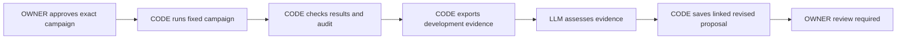

# One supervised research cycle

19 October 2026. Proposed design for owner review. This document does not claim implementation or acceptance.

## Approved objective

Complete one synthetic research campaign, check its results, record an AI assessment, and save one revised proposal.
Stop before registering or executing that next proposal.
Extend the existing implementation in master. Preserve the current uncommitted registration and start work.

The owner approved this scope in the current conversation.
The brainstorming skill requires review of this written design before implementation planning.

## Current evidence

`Coordinator.start_reviewed_campaign` starts one first unit after separate authenticated approval.
It records consumption before dispatch and prevents repeated starts across owner restarts.
The latest source verification passed 120 cases. Successful launch tests use simulation; native start remains unverified.
`ResearchController` already supports cooperative preparation, bounded native workers, completion polling, pause, and recovery checks.
`CampaignReviewController` already supports native scorecards and audits.
`ManualBridge` exports bounded proposal tasks, imports structured responses, saves review plans, and reads linked campaign history.
It does not yet connect checked campaign results to an assessment and revised proposal.

Some native review fixtures manually insert terminal failures to build a completed campaign quickly.
Those fixtures remain useful refusal tests. They cannot establish the complete cycle's acceptance result.

Sources: `src/compertum/ai/start.py`, `research.py`, `campaign_review.py`, `ai/manual.py`, and `ai/history.py`.
Native references: `tests/windows/test_native_development_seals.py` and `tests/windows/test_native_campaign_review.py`.
Authority and limits: `AGENTS.md`, `docs/BUILD_SPEC.md` v1.1, and `docs/TEST_RETENTION.md`.

## Proposed flow

## Campaign continuation

Add one coordinator-owned cycle operation that uses the existing controller and saved campaign records.
Keep the existing first-unit approval unchanged. It must never silently authorize the remaining campaign.
The cycle approval separately binds the registration, campaign, input hashes, fixed schedule, output allowance, and execution deadline.
Persist its exact request and approval before dispatch. Duplicate requests return the original status.
Only one cycle may own research dispatch at a time.

Advance one unit only after the previous unit's exit and saved result are checked.
Reuse `ResearchController.control`, cooperative operations, and the existing native launcher.
Do not build a second worker launcher, campaign scheduler, or artifact store.
Keep all twelve variants and the existing 63-unit schedule.
The cycle must retain genuine failed outcomes and dependency skips. It cannot replace them with successful results.
Reject changed inputs, seals, environment identity, schedule, approval, or output allowances.

Pause and stop must cancel pending work and close active children through the existing controller.
Storage, health, identity, deadline, or recovery failure stops continuation.
Restart remains paused. Resume requires a new authenticated continuation decision after existing recovery checks.
An uncertain launch never retries automatically. Preserve every task, attempt, request, and result identifier.

## Evidence and assessment

After campaign completion, run the existing scorecard and independent deterministic audit paths.
A failed or incomplete audit blocks a claim that the results are checked.
Retain a diagnostic summary for failures, but do not present it as an accepted cycle.

Build a bounded development-evidence packet from checked artifacts and linked history.
Include all variants, actual attempts, failed outcomes, dependency skips, scorecards, audit status, and source artifact hashes.
Keep financial qualification false for synthetic data.
Exclude protected final-test information, credentials, account records, and unrelated files.
Use the existing artifact reservations and bounded reads. Never trust arbitrary paths supplied by a response.

Add a versioned assessment record with one conclusion: supported, contradicted, or inconclusive.
Require the assessment to identify the original hypothesis, evidence packet hash, supporting observations, limitations, and proposed next test.
Missing evidence must remain explicit. A favorable assessment cannot approve execution or promotion.

Use the existing manual AI exchange. Do not start Strata or call a new service.
For this supervised cycle, the current Codex session can assess the exported packet and supply a structured response.
Record that origin honestly. Do not invent a model version, measured inference duration, or independent human approval.
Synthetic response fixtures verify parsing and links only. They cannot stand in for the actual assessment deliverable.

Save the revised proposal through the existing proposal validation path.
Bind it to the original proposal, cycle, evidence packet, and assessment by immutable identifiers and hashes.
Repeated imports must preserve the same record. Conflicting imports must fail.
The revised proposal remains `PROPOSAL_ONLY` and awaits owner review.
Saving it must not register a campaign, dispatch work, or change the sealed variant family.

## Interfaces and storage

Keep the new operation owner-facing, following the existing reviewed registration and start interfaces.
Do not widen command transport permissions in this scope.
The existing foreground controller can drive the supervised engineering acceptance run.

Use the coordinator's existing database ownership and durable request mechanism.
Keep cycle transitions explicit: approved, running, paused, checking results, waiting for assessment, awaiting owner review, or blocked.
Each transition must retain its cause and the evidence needed to verify it.
Derive live worker status from the existing controller; do not create a competing worker-state record.

Store packets, assessments, and proposal links as bounded artifacts through the existing storage manager.
Exact record schemas and byte allowances belong in the implementation plan before code changes.
They must fit existing task, folder, category, and total limits.

## Verification sequence

1. Preserve the starting source identities and existing evidence.
2. Resolve eligible cleanup when its existing process checks permit it. Do not stop unrelated programs.
3. Obtain fresh full storage admission and check host memory before each bounded job.
4. Verify one real native worker through the approved-start action in a new synthetic test runtime.
5. Add source tests for cycle control, pause, restart, uncertainty, and changed evidence.
6. Verify evidence export, assessment validation, proposal linkage, duplicate imports, and refusal paths.
7. Run one complete fixed synthetic campaign through real workers and existing result acceptance.
8. Run its scorecard and deterministic audit. Preserve the actual receipts and every outcome.
9. Assess its exported development packet in this session and import one linked revised proposal.
10. Verify that no next campaign starts. Review independently and refresh reports and the horizontal project map.

Do not mock launch success in the native acceptance run.
Do not insert fake completion records or terminal failures to finish its schedule.
Keep simulated tests, native checks, installed-package checks, and actual research results separate.
Report exact passed, failed, error, and skipped counts.

## Resource and authority boundaries

Keep new spending at $0. Strata, broker actions, paid data, services, and protected evaluation remain excluded.
Keep current identities, interpreters, financial checks, CPU limits, memory limits, and per-unit deadlines unchanged.
Use one heavy job at a time. Keep the 16/12 GiB verification host-memory floors.
Keep source-test jobs at 120 seconds and their existing 4 GiB ceiling.
Keep native research units at their existing 120-second deadlines and output allowances.
Do not assume that one 120-second source-test wrapper can contain the complete campaign.

The implementation plan must specify the foreground acceptance-run deadline and nested process limits before execution.
The build specification's 30-minute experiment-worker limit is a ceiling, not permission to change an existing test wrapper.
If the complete run needs a different outer-job allowance, present its exact bounds before running it.
No background continuation or unattended service is permitted.

Keep 50 GiB total storage and all current category and folder limits.
Use a fresh admitted folder under `.cache/test-runs`. Never change or reuse a consumed runtime to obtain a passing result.
Apply routine cleanup only to eligible disposable files under `TEST_RETENTION.md`.
Preserve failures and results. Do not weaken cleanup checks to bypass unrelated active Python processes.

## Acceptance and stopping rules

Accept the engineering cycle only when a real synthetic campaign reaches its terminal schedule through the existing runner.
Its scorecard and audit must verify, and every actual outcome must remain traceable.
The packet, real assessment, and revised proposal must reference the same immutable evidence.
The final state must await owner review with no pending or active next campaign.
Cancellation and restart tests must prove that uncertain effects cannot cause duplicate execution.
Independent review must have no unresolved blocking issue.

This outcome does not establish financial qualification, M3 acceptance, M5 paper acceptance, or any M6 session.
If native identity, capacity, cleanup ownership, or authority blocks acceptance, preserve the failure and report the exact unfinished criterion.
Complete independent source work where possible. Do not substitute simulation for missing native proof.
Use at most three repair/review rounds per failure class. Do not silently restart exhausted attempts.

## Alternatives considered

Manual stepping alone preserves existing behavior but does not provide the approved supervised cycle or durable continuation authority.
A new general agent framework would duplicate existing ownership, scheduling, and storage controls.
The selected approach adds a small cycle controller and evidence links around the existing components.

## Next action

Review this design, then prepare the implementation plan with exact files, schemas, resource bounds, and validation commands.
Implementation remains pending that required design review.
