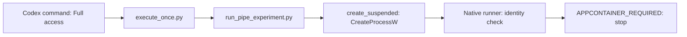

# Why the pipe launch lacked AppContainer identity

Date: 18 October 2026.

The experiment started outside AppContainer. The Compertum launcher did not remove an existing AppContainer identity.
The active chat used Full access. Its command processes inherited that execution context.
The smallest proposed correction changes this chat's permission selection, then verifies the resulting identity before any experiment.
No runtime code change is proposed.

## Evidence

The current chat's recorded turns all use `danger-full-access`, approval policy `never`, and permission profile `disabled`.
This includes the turn that launched `pipe-isolated01` and the current diagnosis turn.
The record starts with that mode. It does not show who selected it or when an earlier mode changed.
Do not attribute the change to the owner or to an automatic app action without further evidence.

The saved `C:\Users\bgonn\.codex\config.toml` contains different defaults:

```toml
approval_policy = "on-request"
sandbox_mode = "workspace-write"

[windows]
sandbox = "elevated"
```

Only these relevant settings were inspected. Credentials and authentication stores were not read.
The active turn records, rather than saved defaults, describe the failed command's effective permissions.
Editing these already-correct defaults would not address the active chat selection.
The Windows backend setting does not prove that a sandbox is active or that a particular application identity will return.

The older `pipe-identity01-result.json` reports AppContainer membership for both observer and parent.
Their effective identities match, with integrity level 4096.
The failed `pipe-isolated01.result.json` reports `APPCONTAINER_REQUIRED` during the first current-process identity check.
That check occurs before client creation and before `CreateNamedPipeW`.
Both failed-attempt and storage parent jobs observed exit and closed every child.

## Launch path



`execute_once.py` uses the existing Python executable through `subprocess.run`.
The wrapper calls `create_suspended` without an inherited-handle list.
In `src/compertum/runtime/jobs.py`, that branch calls `CreateProcessW` with suspended, Unicode-environment, and hidden-window flags.
It supplies no replacement token or security-capabilities attribute.
Microsoft documents that [CreateProcessW uses the caller's security context](https://learn.microsoft.com/en-us/windows/win32/api/processthreadsapi/nf-processthreadsapi-createprocessw).
The Windows Job applies processor, memory, lifetime, and child limits. Those limits do not create an AppContainer identity.
The native runner checks its process token before any experimental client or pipe exists.
Its unchanged identity check correctly refused the supplied context.

This is an execution-context mismatch between an earlier observation and a later launch.
There is no evidence of a token being stripped inside the Compertum launch path.
There is also no evidence that the proposed pipe grant succeeded or failed. The attempt never reached it.
The execution preparation checked source bindings but did not reject the active chat mismatch before the full storage check.
That ordering wasted the storage check for this experiment. The proposed workflow verifies identity first.

## Prepared correction and limits

The proposed change is only Full access to Ask for approval for this chat.
The effective target is `workspace-write`, `on-request`, and `approvals_reviewer = "user"`.
The Windows backend, global defaults, source code, identity pins, and pipe descriptor remain unchanged.
The exact approval wording and verification conditions are in `docs/M5_PIPE_LAUNCH_CONTEXT_PLAN.md`.

Official documentation describes the permission control beneath the composer and the corresponding sandbox and approval settings.
It also distinguishes active permissions from the Windows sandbox implementation.
See [sandbox permissions](https://learn.chatgpt.com/docs/sandboxing) and [Windows sandbox behavior](https://learn.chatgpt.com/docs/windows/windows-sandbox).

The mode change remains unapplied. Its effect on this machine is not yet verified.
A fresh query-only identity check must match the original user, logon, application identity, and integrity level.
A different identity requires a new review. Do not rewrite the original pins to pass that check.
The next approval does not include a full scan, another pipe attempt, or any broker action.

## Review and verification

Independent review round 1 accepted this preparation with no blocking findings.
The reviewer confirmed that a session-only correction is smaller than changing launch code, global defaults, or Windows setup.
The reviewer independently verified all 16 source pins, all ten failed-attempt evidence files, and all six older evidence files.
The historical identity file also retained its expected hash.
The review does not establish a repaired launch or authorize the proposed permission change.
Thirteen artifact and configuration checks passed, with zero failures and zero skips.
These checks compared saved records, hashes, and selected settings. They did not query a new native token or test a repaired launch.
The private receipt is `.cache/test-runs/m5-local-economics-20261017-01/pipe-context-preparation01/diagnosis.json`.
No source suite, installed-package suite, storage scan, pipe experiment, or broker stage ran during this diagnosis.
The prior failed experiment remains one failed attempt with zero retries.
The prior 132 passing source tests remain historical preparation evidence.
Paper trading and unattended production work remain blocked.
